# Architecture de HAPanel

Document pour les ingénieurs qui reprennent ou font évoluer le projet. Il explique le
fonctionnement global ; le détail et l'historique des choix sont dans
[02_DECISIONS.md](codex/02_DECISIONS.md), notés `Dnnn` ci-dessous. Le détail de chaque
fichier YAML, bloc par bloc, est dans [technique/](technique/README.md).

État décrit : version `0.7.0`, fusion `bffcabe`, ESPHome 2026.10.1.

## Vue d'ensemble

HAPanel est un panneau mural sur ESP32 sans PSRAM, réalisé en YAML ESPHome avec LVGL.
Trois idées structurent tout le reste :

- **Le module ne décide de rien (D007).** Il affiche des valeurs et émet des demandes.
  Toute action sur un appareil est exécutée par Home Assistant (HA).
- **Un seul binaire, aucune entité compilée (D012).** Le firmware ne connaît que des
  clés génériques. Le choix des entités se fait dans HA, par une automatisation par
  module, créée depuis un blueprint unique (D021).
- **Le panneau ne ment pas (P2 à P4).** Une valeur inconnue, indisponible ou ancienne
  est affichée comme telle, et aucune commande ne se calcule à partir d'elle.

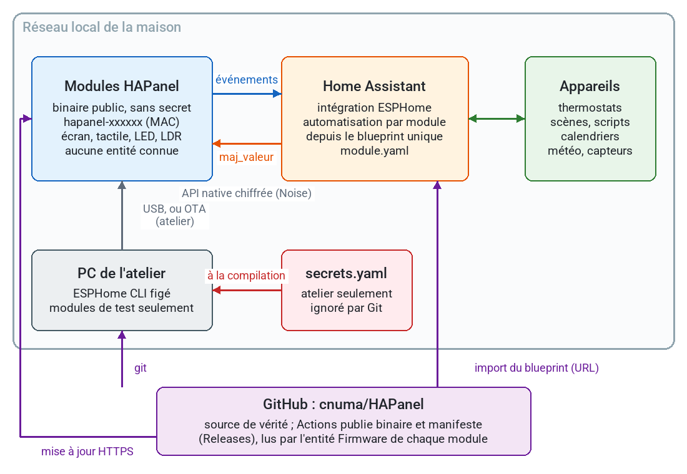

| Chemin | Protocole | Sens | Rôle |
|---|---|---|---|
| Action `maj_valeur(cle, valeur)` | API native chiffrée | HA vers module | Toutes les valeurs affichées |
| Événement `esphome.hapanel_demande_valeurs` | API native | Module vers HA | Demande un envoi complet à la connexion |
| Événement `esphome.hapanel_commande` | API native | Module vers HA | Toutes les commandes |
| Action `message_accueil(texte, infos)` | API native chiffrée | HA vers module | Message d'accueil (D028), section du blueprint `module.yaml` (D042) |
| OTA | Réseau local chiffré | PC vers module | Mise à jour du firmware (modules privés, `hapanel.yaml`) |
| Entité « Firmware » | HTTPS depuis GitHub | GitHub vers module, lancée depuis HA ou depuis l'écran du module (D047) | Mise à jour du binaire public (D039) ; recherche au démarrage, à 3 h et par le bouton d'À propos |

## Organisation du YAML

### Du YAML au firmware

Le YAML ne s'exécute pas sur le module : c'est la description d'un firmware. ESPHome lit les
fichiers, les assemble en une seule configuration, génère du C++ et le compile. Les blocs
s'appliquent donc à deux moments :

| Moment | Éléments | Exemple |
|---|---|---|
| Compilation | `!include`, `!secret`, `substitutions`, `packages`, `!extend` | `${retro_nuit}` devient `0.40` dans le code généré |
| Exécution | `lambda`, `script`, `interval`, `on_click`, `api.actions` | `maj_valeur` traite une valeur reçue |

Tout s'exécute dans la boucle principale d'ESPHome. Une attente dans une lambda bloque donc l'écran,
le tactile et le réseau (G1). Ces lambdas restent du C++, inséré tel quel dans le code généré.

### Les fichiers

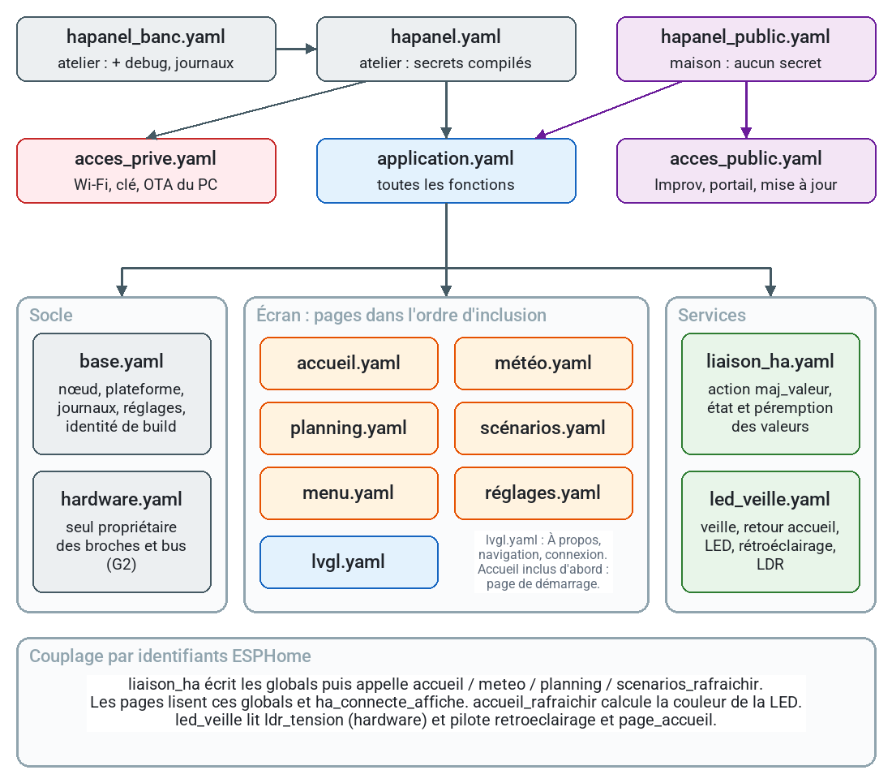

| Fichier | Lignes | Responsabilité |
|---|---|---|
| `hapanel.yaml` | 19 | Atelier (modules de test) : substitutions, fonctions (`application`) et accès privé |
| `hapanel_banc.yaml` | 33 | Banc de l'atelier : `hapanel.yaml`, plus mémoire mesurée, journaux DEBUG et dossier de compilation propre |
| `hapanel_public.yaml` | 25 | Modules de la maison : binaire public sans secret, fonctions et accès public (D039, D037 révisée) |
| `packages/application.yaml` | 20 | Liste ordonnée des fichiers de fonctions, commune aux configurations |
| `packages/acces_prive.yaml` | 26 | Wi-Fi, clé de l'API et OTA depuis le PC, lus dans `secrets.yaml` ; scripts de mise à jour vides (D047) |
| `packages/acces_public.yaml` | 332 | Wi-Fi saisi à l'installation, clé reçue de HA, mises à jour depuis GitHub, mise à jour en attente signalée (D045), recherche, confirmation et installation depuis l'écran (D047) |
| `packages/base.yaml` | 50 | Nœud, journaux, écriture des réglages, identité de build (puce : fichier matériel, D049) |
| `packages/hardware.yaml` | 126 | Carte ESP32-2432S024C : puce, broches, bus, écran, tactile, sorties PWM, LDR (G2) |
| `packages/hardware_2432s028.yaml` | 132 | Carte ESP32-2432S028 : mêmes `id`, rétroéclairage GPIO21, tactile résistif XPT2046 |
| `packages/hardware_jc4827w543.yaml` | 138 | Carte Guition JC4827W543 (4,3", ESP32-S3) : mêmes `id`, écran QSPI tourné en portrait, tactile GT911, LED et LDR sans effet (D049) |
| `hapanel_2432s028_banc.yaml` | 38 | Banc sur carte ESP32-2432S028 |
| `hapanel_2432s028_public.yaml` | 24 | Binaire public de la carte ESP32-2432S028 (D041) |
| `hapanel_jc4827w543_public.yaml` | 24 | Binaire public de la carte Guition JC4827W543 (D049) |
| `packages/lvgl.yaml` | 401 | Polices communes, À propos (version, SHA, connexion, adresse IP, mémoire, bouton de recherche de mise à jour, D047), barre d'état en haut (titre, disquette, mise à jour, Wi-Fi, HA, ☰, D036, D045) et bouton Accueil en bas, suivi de la connexion |
| `packages/liaison_ha.yaml` | 489 | Action `maj_valeur`, valeurs reçues, effacement, péremption |
| `packages/led_veille.yaml` | 320 | Veille, retour à l'accueil, LED, rétroéclairage, réglages du module (D027, D031) |
| `packages/message_accueil.yaml` | 160 | Action `message_accueil`, message plein écran, entité « Message d'accueil » |
| `packages/pages/accueil.yaml` | 764 | Température, chauffage, commandes, couleur de la LED |
| `packages/pages/meteo.yaml` | 194 | Conditions et prévisions |
| `packages/pages/planning.yaml` | 378 | Résumé et frises |
| `packages/pages/scenarios.yaml` | 365 | Boutons et lancement |
| `packages/pages/menu.yaml` | 151 | Tuiles de navigation, tuile « Mise à jour » (D047) |
| `packages/pages/reglages.yaml` | 216 | Réglages de la LED et de l'écran, synchronisés avec HA, cadenas si imposés (D031) |
| `secrets.yaml` | | Wi-Fi et clé d'API des modules de l'atelier, hors de Git (G9) |

**Pour lire le projet :** `hapanel.yaml`, puis `liaison_ha.yaml`, puis `scenarios.yaml`, qui est la
page la plus simple à commander. `accueil.yaml` est la plus dense et se lit en dernier.

### Comment les fichiers s'assemblent

`packages/application.yaml` les liste ; `hapanel.yaml` l'inclut avec un fichier d'accès, et
ESPHome fusionne le tout en une seule configuration :

```yaml
# hapanel.yaml
substitutions:
  node_name: hapanel
  version: "0.0.0-non-injectee"
packages:
  hardware: !include packages/hardware.yaml   # la carte : un fichier par modele
  application: !include packages/application.yaml
  acces: !include packages/acces_prive.yaml

# packages/application.yaml
packages:
  base: !include base.yaml
  accueil: !include pages/accueil.yaml
  # autres pages, puis lvgl, liaison, led_veille, message_accueil
```

`hapanel_public.yaml` inclut le même `application.yaml` avec `acces_public.yaml` : les deux
binaires ont exactement les mêmes fonctions (D039).

Un même bloc peut donc apparaître dans plusieurs fichiers. Chaque package y ajoute sa part :

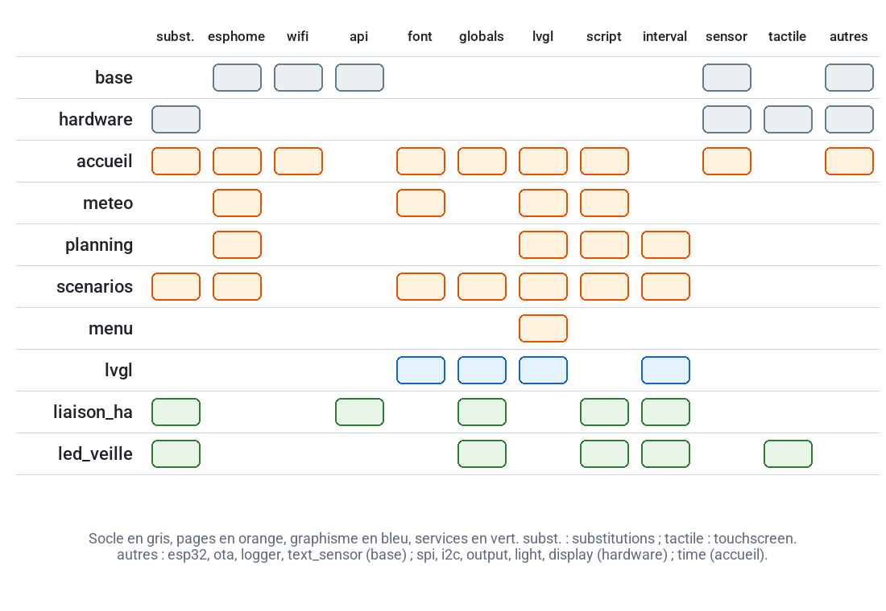

**Lecture :** une ligne par fichier, une colonne par bloc YAML (`script:`, `sensor:`…) ; une
case indique que le fichier déclare ce bloc. Une colonne qui a plusieurs cases est un bloc
réparti : la colonne `script` montre que les scripts sont écrits dans 7 fichiers, et ESPHome
les réunit en une seule liste. Pour retrouver un script ou un `id`, il faut donc chercher dans
tous les fichiers de sa colonne.

- **Listes :** `script`, `globals`, `interval`, `sensor` ou `lvgl.pages` s'additionnent.
- **Ordre d'inclusion :** il fixe l'ordre des pages, et la première est affichée au démarrage.
  `accueil.yaml` doit donc rester avant `lvgl.yaml`.
- **Substitutions :** celles du fichier principal priment. `hapanel_banc.yaml` passe ainsi `log_level`
  à DEBUG, et `tools/build.ps1` impose `version` et `git_sha`.
- **`!extend` :** complète un composant déclaré ailleurs, sans modifier son fichier. `led_veille.yaml`
  ajoute le réveil à `tactile`, déclaré dans `hardware.yaml`.
- **Couplage :** tous les `id` sont globaux, sans encapsulation. Renommer un `id` ou une entité
  exposée exige une décision (G10).

Pour voir le résultat de la fusion, sans publier cette sortie :

```powershell
.\tools\build.ps1 config
```

### Anatomie d'un package de page

Les pages suivent le même plan, chacune ne déclarant que les blocs utiles. Par exemple,
`scenarios.yaml` :

```yaml
substitutions:        # délais réglables
font:                 # icônes, glyphes limités (G6)
esphome:
  on_boot:            # premier affichage, sans HA
globals:              # état propre à la page
lvgl:
  pages:
    - id: page_scenarios
      widgets:        # disposition et on_click
script:
  - id: scenarios_lancer      # commande
  - id: scenarios_rafraichir  # redessine la page
interval:             # délais d'attente
```

**Règle centrale :** une page qui reçoit des valeurs a un seul script `*_rafraichir`, qui recalcule ses
widgets à partir des `globals`. Les autres blocs modifient l'état puis l'appellent. Seuls des éléments
indépendants des valeurs font exception, comme l'heure, le Wi-Fi ou la page À propos.

| Bloc | Rôle | Dans le projet |
|---|---|---|
| `substitutions` | Constante remplacée à la compilation | `pin_ldr`, `veille_delai_ms` |
| `globals` | Variable C++ partagée entre packages | `liaison_chauffage_etat` |
| `lvgl.pages` | Widgets d'un écran | `page_meteo` |
| `lvgl.top_layer` | Widgets au-dessus de toutes les pages | Barre d'état, bouton Accueil |
| `api.actions` | Fonction appelable par HA | `maj_valeur` |
| `script` | Fonction interne, avec paramètres possibles | `scenarios_lancer(indice)` |
| `mode: restart` | Un nouvel appel annule le précédent | Attente de 2 s de la consigne |
| `interval` | Tâche périodique | Péremption |
| `homeassistant.event` | Événement vers HA | `esphome.hapanel_commande` |

### Le fonctionnement à l'exécution

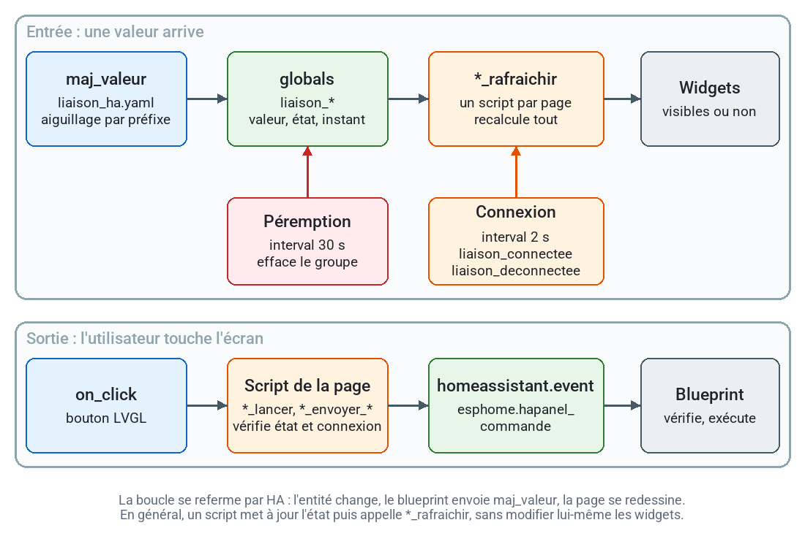

Les tâches périodiques donnent le rythme du module :

| Période | Fichier | Tâche |
|---|---|---|
| 50 ms | `led_veille.yaml` | Respiration de la LED, arc-en-ciel du message d'accueil, éclairs de mise à jour (D045) |
| 500 ms | `led_veille.yaml` | Clignotement d'alerte |
| 500 ms | `lvgl.yaml` | Clignotement de l'icône de mise à jour (D045) |
| 1 s | `led_veille.yaml` | Retour à l'accueil, veille, réveil sans HA |
| 1 s | `scenarios.yaml` | Délais de réponse et de message |
| 1 s | `message_accueil.yaml` | Fermeture du message d'accueil après 3 min |
| 1 s | `acces_public.yaml` | Mise à jour en attente (`maj_disponible`), tuile du Menu et bouton d'À propos, fermeture de la confirmation sans toucher (binaire public seulement, D047) |
| 3 h chaque nuit | `acces_public.yaml` | Recherche d'une mise à jour, heure de HA (D047) ; une autre 10 s après la première connexion au Wi-Fi |
| 2 s | `lvgl.yaml` | Connexion à HA |
| 10 s | `led_veille.yaml` | Obscurité et rétroéclairage |
| 10 s | `lvgl.yaml` | Mémoire affichée dans À propos |
| 30 s | `liaison_ha.yaml` | Péremption des valeurs |
| 30 s | `planning.yaml` | Redessin du planning |

S'y ajoutent des lectures matérielles déclarées dans `hardware.yaml` : tactile toutes les 50 ms et LDR
toutes les 2 s.

### Conventions de nommage

| Forme | Sert à | Exemple |
|---|---|---|
| `page_<nom>` | Page | `page_accueil` |
| `btn_`, `lbl_`, `ico_` + zone | Bouton, texte, icône | `btn_sce_1`, `lbl_apropos_sha` |
| `liaison_<valeur>` | Valeur reçue de HA | `liaison_meteo_etat` |
| `<page>_<fonction>` | Script ou état d'une page | `accueil_envoyer_mode` |
| `police_<usage>` | Police | `police_titre` |
| `pin_<fonction>` | Broche | `pin_led_rouge` |
| `sortie_<fonction>` | Sortie PWM | `sortie_led_bleu` |

### Où modifier quoi

| Besoin | Fichier |
|---|---|
| Broche ou composant matériel | Fichier matériel de la carte (`hardware.yaml`, `hardware_2432s028.yaml`) |
| Disposition ou texte d'une page | `lvgl.pages` de `pages/<page>.yaml` |
| Logique d'affichage | Script `*_rafraichir` de la page |
| Nouvelle clé reçue de HA | `liaison_ha.yaml` et le blueprint |
| Nouvelle commande | Script de la page et blueprint |
| Délai réglable | `substitutions` du fichier concerné |
| Barre d'état et bouton Accueil | `top_layer` de `lvgl.yaml` |
| Nouvelle page | Voir [Navigation et interface](#navigation-et-interface) |

Le second blueprint, `envoyer_valeur.yaml`, reste un outil générique : `module.yaml` ne s'en sert pas.

## Matériel

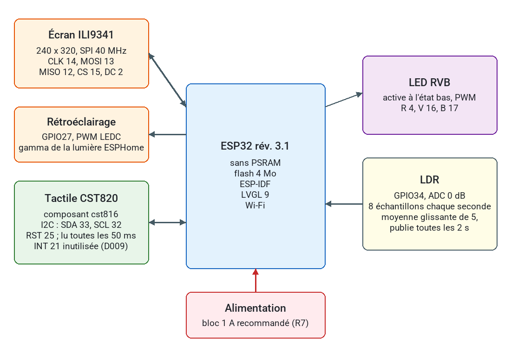

Le schéma montre la carte de référence, une ESP32-2432S024C (D004), au brochage
publié sans documentation vendeur et confirmé au banc (R6). L'ESP32-2432S028 a son
propre fichier matériel, avec les mêmes `id` : rétroéclairage GPIO21, tactile résistif
XPT2046 sur un second bus SPI (`docs/technique/hardware_2432s028.md`, D041). La Guition
JC4827W543 (4,3", ESP32-S3) aussi : écran QSPI tourné en portrait par LVGL, pages
centrées, ni LED ni LDR (`docs/technique/hardware_jc4827w543.md`, D049). Deux
particularités de la S024C :

- Aucune interruption n'arrive sur GPIO21 : le tactile est lu toutes les 50 ms (D009, dette T1).
- Un pic de courant au démarrage du Wi-Fi peut faire redémarrer la carte sur un port
  USB de PC et provoquer un retour silencieux au binaire précédent (R7).

## Le blueprint

### Qu'est-ce qu'un blueprint ?

Un blueprint est un **modèle d'automatisation paramétrable** de Home Assistant. Une
automatisation classique écrit ses entités en dur. Le blueprint les remplace par des
questions : l'administrateur y répond dans un formulaire, sans écrire de YAML.

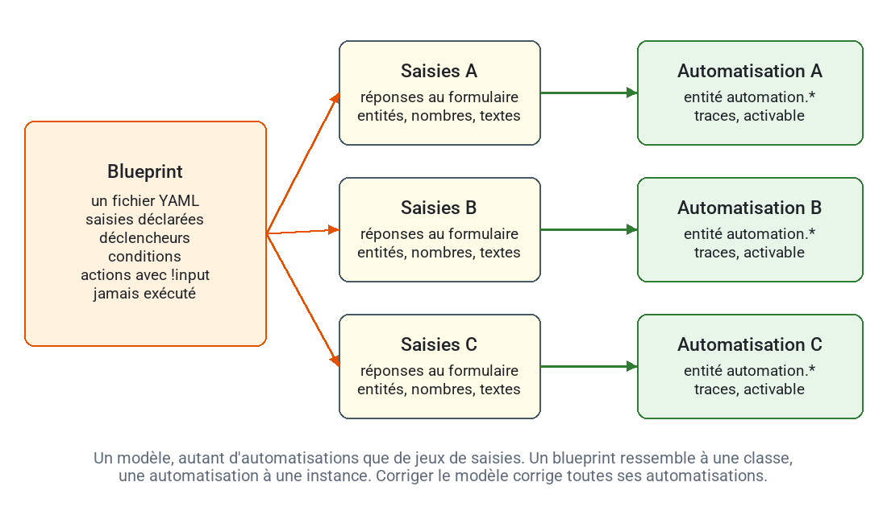

Le fichier a deux parties : l'en-tête `blueprint:` déclare le nom et les saisies, le reste
est le corps d'une automatisation. Exemple générique, sans lien avec HAPanel :

```yaml
blueprint:
  name: Lumière sur mouvement
  domain: automation
  input:
    capteur:
      name: Détecteur
      selector:
        entity:
          filter:
            - domain: binary_sensor
    lampe:
      name: Lampe
      selector:
        entity:
          filter:
            - domain: light

triggers:
  - trigger: state
    entity_id: !input capteur
    to: "on"
actions:
  - action: light.turn_on
    target:
      entity_id: !input lampe
```

Trois propriétés à retenir :

- **Il n'est jamais exécuté.** Un blueprint n'a ni entité, ni déclencheur actif, ni trace :
  seules les automatisations créées à partir de lui en ont.
- **`!input` est résolu au chargement.** HA remplace la balise par la saisie avant de
  démarrer l'automatisation, ce qui permet de l'utiliser dans un déclencheur.
- **`{{ ... }}` est évalué à l'exécution.** Un modèle Jinja lit l'état du moment, mais ne
  voit pas `!input` : il faut d'abord copier la saisie dans `variables:`.

### Comment l'utiliser

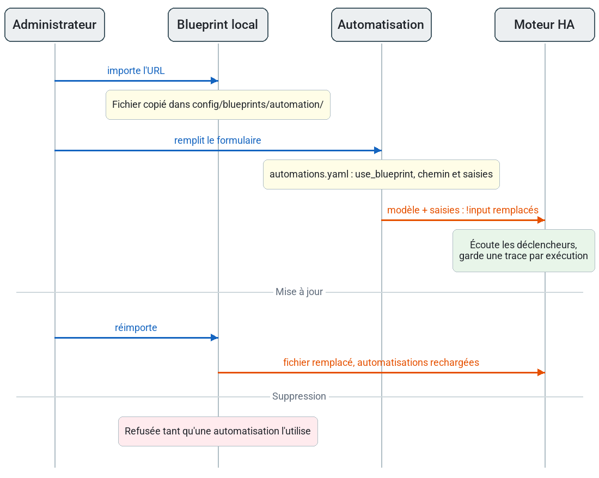

- **Importer :** HA télécharge le fichier depuis son URL. Depuis GitHub, il propose par
  défaut le chemin `<propriétaire>/<fichier>`, soit `cnuma/module.yaml` ici.
- **Créer l'automatisation :** HA construit le formulaire à partir des saisies.
- **Enregistrer :** HA n'écrit dans `automations.yaml` que la référence et les réponses,
  pas le corps de l'automatisation.

```yaml
- alias: Lumière du couloir
  use_blueprint:
    path: exemple/lumiere.yaml
    input:
      capteur: binary_sensor.couloir
      lampe: light.couloir
```

**On n'appelle pas un blueprint.** Rien ne le lance directement : ce sont les déclencheurs de
ses automatisations qui démarrent leur exécution, comme pour toute automatisation.

**Mettre à jour :** réimporter remplace le fichier local et recharge les automatisations qui
l'utilisent, sans modifier leurs saisies. Une nouvelle saisie obligatoire doit donc être
remplie à la main.

**Observer :** chaque exécution laisse une trace, consultable depuis l'automatisation, avec le
déclencheur, les conditions et les actions suivies. Le fichier du blueprint n'en a pas.

### Comment le personnaliser

Il y a deux niveaux : répondre au formulaire, ou modifier le modèle.

**Le formulaire** est le cas normal. Chaque saisie porte un `selector` qui fixe son champ :

| Selector | Champ | Valeur obtenue | Dans HAPanel |
|---|---|---|---|
| `device` | Liste d'appareils | Identifiant de l'appareil | `panneau` |
| `entity` | Liste d'entités, filtrée par domaine | `entity_id` | Thermomètres, thermostat, météo, scénarios |
| `entity` avec `multiple` | Plusieurs entités | Liste d'`entity_id` | `calendriers` |
| `number` | Nombre borné | Nombre | `consigne_min`, `consigne_max` |
| `text` | Texte libre | Texte | `nom_N` |
| `select` | Liste de choix | Valeur du choix | `icone_N`, `couleur_N` |

- **Obligatoire ou non :** une saisie sans `default` est obligatoire.
- **Section :** `collapsed: true` replie un groupe dans le formulaire. Les noms de saisies
  restent à plat : on écrit `!input scenario_1`, sans la section.
- **Répétition :** `&scenario` et `<<: *scenario` sont des ancres YAML, résolues à la lecture
  du fichier. Elles évitent de répéter six fois chaque champ.

**Modifier le modèle** est nécessaire quand le formulaire ne suffit plus :

| Besoin | Où agir | Recompiler le module ? |
|---|---|---|
| Changer d'entité, de bornes, de nom, d'icône choisie | Formulaire de l'automatisation | Non |
| Équiper un module de plus | Nouvelle automatisation | Non |
| Changer un calcul ou un contrôle, mêmes clés | Blueprint, puis réimport | Non |
| Ajouter une valeur affichée ou une commande | Blueprint et firmware | Oui |
| Ajouter une icône ou une couleur | Blueprint et `scenarios.yaml` | Oui |
| Changer un délai du module | Firmware | Oui |

Le dépôt reste la source : un fichier modifié directement dans `config/blueprints/` sera écrasé
par le prochain réimport. **Prendre le contrôle**, dans le menu de l'automatisation, la convertit en
automatisation autonome : elle devient modifiable, mais ne suit plus les évolutions du blueprint.

### Structure du YAML

Tout blueprint d'automatisation suit le même plan. Seul l'en-tête `blueprint:` lui est propre ; le
reste est le corps d'une automatisation ordinaire.

| Bloc | Fonction | Quand HA l'utilise |
|---|---|---|
| `blueprint:` | Décrit le modèle et déclare ses saisies | À l'import et dans le formulaire |
| `mode:`, `max:` | Règle les exécutions simultanées | À chaque déclenchement |
| `variables:` | Calcule des valeurs communes à toute l'exécution | Après le déclencheur, avant les conditions |
| `triggers:` | Dit quand démarrer | En permanence, automatisation active |
| `conditions:` | Dit s'il faut continuer | Après `variables:` |
| `actions:` | Dit quoi faire | Si les conditions sont remplies |

`blueprints/automation/hapanel/module.yaml` s'organise ainsi :

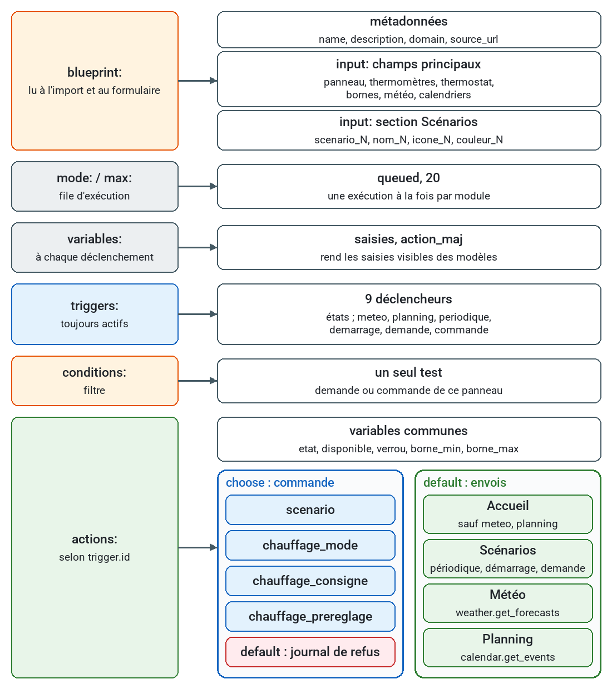

```yaml
blueprint:            # nom, source_url, saisies
  input:
    panneau:          # puis les autres saisies
    scenarios:        # section repliée
      input:          # 6 groupes de 4 champs
mode: queued          # une exécution à la fois
max: 20
variables:            # saisies + action_maj
triggers:             # états, horloge, événements
conditions:           # événement de ce panneau ?
actions:
  - variables:        # état du thermostat, bornes
  - choose:
      - conditions:   # trigger.id == commande
        sequence:
          - choose:   # une branche par commande
            default:  # journal de refus
    default:          # tout autre déclencheur
      - if:           # envoi Accueil
      - if:           # envoi Scénarios
      - if:           # envoi Météo
      - if:           # envoi Planning
```

Trois choix structurent le fichier :

- **`trigger.id` aiguille tout.** Il n'y a qu'une automatisation : l'identifiant du déclencheur
  sélectionne soit une commande, soit les groupes de valeurs à envoyer. Les déclencheurs de
  température et de thermostat n'ont pas d'identifiant et n'envoient que l'accueil.
- **Commande et envoi s'excluent.** Une commande n'envoie pas de valeurs ; sa confirmation revient
  par le changement d'état de l'entité. Seul le scénario répond directement, avec `scen_resultat`.
- **Chaque groupe d'envoi suit le même motif.** Un `repeat` parcourt une liste de paires
  `cle` et `valeur`, et appelle `action_maj` pour chacune. Ajouter une valeur revient donc à ajouter
  une paire, puis à la traiter dans le firmware.

### Son rôle dans HAPanel

Le blueprint est la seule pièce qui connaît à la fois les entités de la maison et les clés du
firmware. Il traduit dans les deux sens.

```yaml
- alias: HAPanel salon
  use_blueprint:
    path: cnuma/module.yaml
    input:
      panneau: <identifiant de l'appareil>
      thermometre: sensor.temperature_sejour
      thermostat: climate.sejour
      meteo: weather.maison
      calendriers:
        - calendar.chauffage_sejour
      scenario_1: scene.soiree
      nom_1: Soirée
      icone_1: film
      couleur_1: violet
```

*Exemple : les entités sont fictives, et les autres saisies suivent le même principe.*

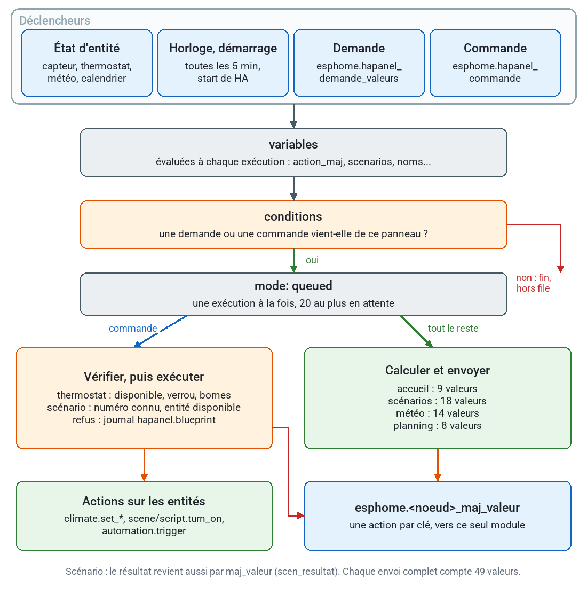

Chaque élément de HA y joue un rôle précis :

| Élément de HA | Rôle dans HAPanel | Usage dans le blueprint |
|---|---|---|
| Registre des appareils | Identifie le module | `panneau`, `device_attr` |
| Intégration ESPHome | Relie HA au module | Publie l'action `maj_valeur`, relaie les événements en ajoutant `device_id` |
| Bus d'événements | Reçoit les demandes du module | Déclencheurs `event` |
| `sensor` | Températures | État lu avec `states()` |
| `climate` | Thermostat | Attributs lus, puis `climate.set_hvac_mode`, `set_temperature`, `set_preset_mode` |
| `weather` | Météo | État, puis `weather.get_forecasts` |
| `calendar` | Planning | `calendar.get_events` sur la journée, converti en 96 bits |
| `scene`, `script` | Scénarios | `turn_on` |
| `automation` | Scénarios, et l'automatisation du module elle-même | `automation.trigger`, qui ignore les conditions |
| Journal système | Refus de commande | `system_log.write`, journal `hapanel.blueprint` |

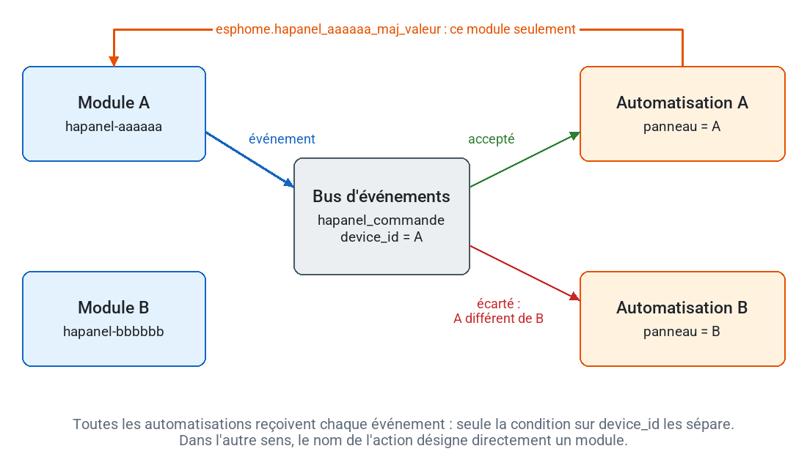

**Plusieurs modules :** les conditions sont évaluées avant le lancement des actions. Un événement
d'un autre panneau s'arrête donc là et n'occupe pas la file d'attente. Chaque module a sa propre file.

**Types de valeurs :** HA convertit le résultat d'un modèle en type natif. Un `valeur` égal à `21.5`
devient un nombre, d'où le test `valeur is number` sur la consigne. C'est aussi pourquoi les créneaux
portent le préfixe `h` (D020).

**Pièges propres au projet :**

- **Nom de l'action :** il est reconstruit à partir du nom de l'appareil dans `action_maj`. HA donne
  à l'appareil le `friendly_name`, et ESPHome nomme l'action d'après le nœud. Les deux coïncident
  aujourd'hui : modifier `friendly_name` ou `name` peut donc couper tous les envois (G10).
- **Remplacement d'un module :** le nouvel appareil a un autre identifiant. Il faut choisir de
  nouveau `panneau` dans le formulaire.
- **Enregistrement du formulaire :** il ne déclenche aucun envoi. Un nouveau nom de scénario arrive au
  prochain cycle de 5 min, ou à la reconnexion du module.
- **Verrou :** un thermostat sans attribut `is_locked` est considéré comme non verrouillé.
- **Deux automatisations pour un module :** chaque commande est alors exécutée deux fois.

## Flux des valeurs

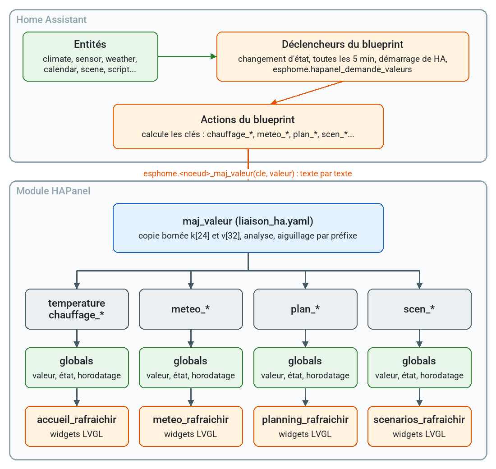

Le blueprint pousse les valeurs une à une, sous forme de texte. `maj_valeur` copie clé
et valeur dans des tampons bornés (24 et 32 octets), car les paramètres pointent dans le
tampon de réception sans zéro terminal.

| Préfixe | Clés | Lecture |
|---|---|---|
| `piece` | nom de la pièce (D040) | Écrit directement dans `lbl_acc_sejour`, sans état ni péremption |
| `temperature*` | `temperature`, `temperature_exterieure` | `accueil_rafraichir` |
| `chauffage_*`, `consigne_*` | mode, action, consigne, préréglage, verrou, bornes | `accueil_rafraichir` |
| `meteo_*` | condition, température, `meteo_jN_*` (N de 1 à 3) | `meteo_rafraichir` |
| `plan_*` | `plan_N_nom`, `plan_N_creneaux` (N de 1 à 4) | `planning_rafraichir` |
| `scen_*` | `scen_N_nom`, `scen_N_icone`, `scen_N_couleur` (N de 1 à 6), `scen_resultat` | `scenarios_rafraichir` |
| `led_*` | `led_mode`, `led_intensite`, `led_alerte`, seulement si le blueprint les impose | Entités de configuration du module (D027) |

**Traitement à part :** météo, planning et scénarios ne redessinent que leur page, pour ne
pas rafraîchir le chauffage et sa logique de commande à chaque valeur.

**Créneaux du planning :** `h` puis 24 chiffres hexadécimaux, soit 96 bits d'un quart
d'heure chacun. Le préfixe évite que HA interprète la chaîne comme un nombre (D020).

**Quand le blueprint envoie :**

| Déclencheur | Envoi |
|---|---|
| Changement d'un capteur ou du thermostat | Accueil |
| Changement de la météo | Météo |
| Changement d'un calendrier | Planning |
| Toutes les 5 min, démarrage de HA, demande du module | Tout |

Le `mode: queued` du blueprint sérialise les exécutions, avec 20 au plus en attente. Une
commande peut donc attendre la fin d'un envoi en cours.

## Connexion à Home Assistant

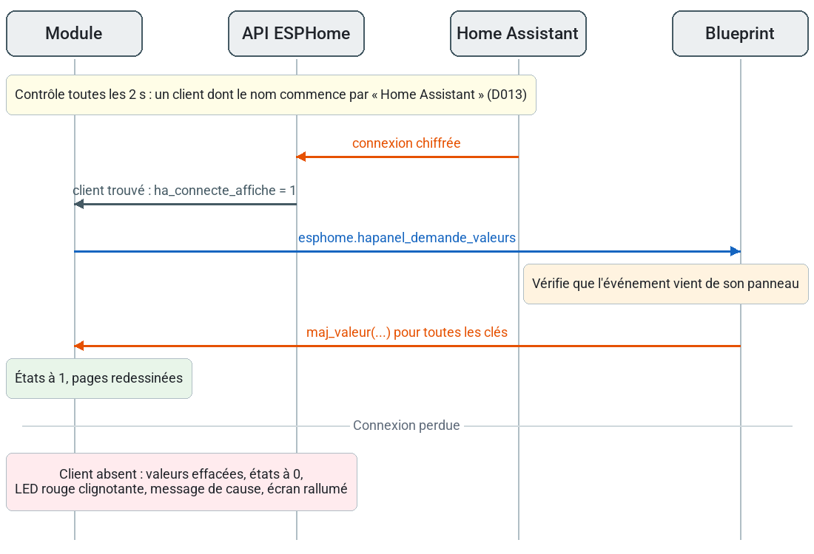

`state_subscription_only` ne suffit pas : `esphome logs` s'abonne aussi aux états. Le
module considère donc HA connecté seulement si un client de l'API s'annonce avec un nom
commençant par « Home Assistant » (D013). Ce contrôle a lieu toutes les 2 s.

## Cycle de vie d'une valeur

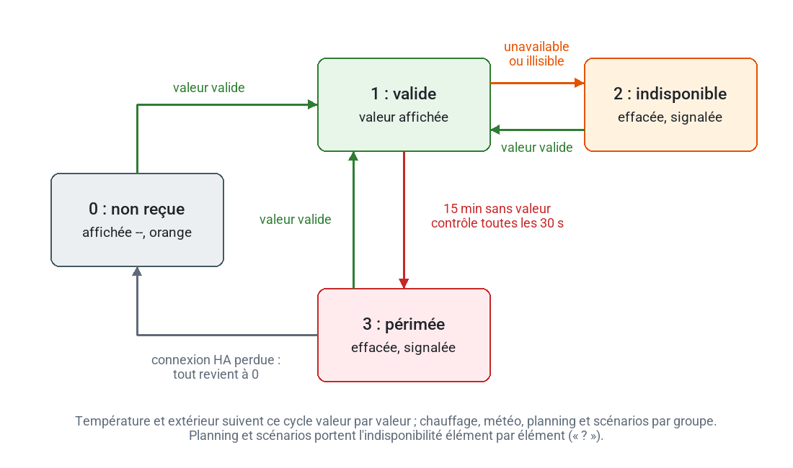

Chaque valeur ou groupe porte un état et l'instant de sa dernière réception. Un
`interval` de 30 s applique une péremption de 15 min. C'est le garde-fou quand le
blueprint est absent ou en erreur (R9).

## Commandes

Une commande est un événement `esphome.hapanel_commande` avec `commande` et `valeur`. HA y
ajoute le `device_id`, que le blueprint compare à son panneau.

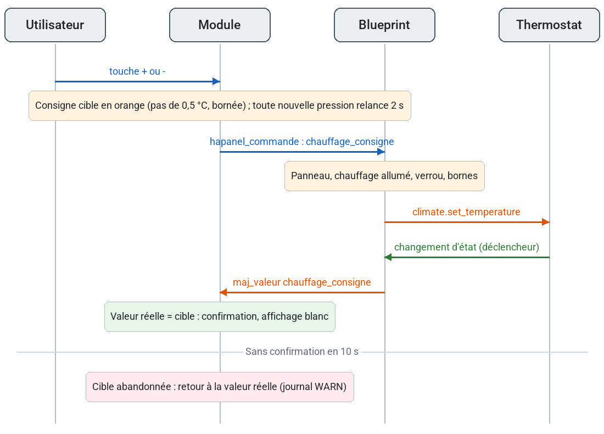

**Accueil :** le module applique une confirmation optimiste. La cible s'affiche en orange
jusqu'à ce que la valeur réelle la rejoigne, ou elle est abandonnée après 10 s. Le mode et
le préréglage suivent le même schéma, sans le délai de 2 s.

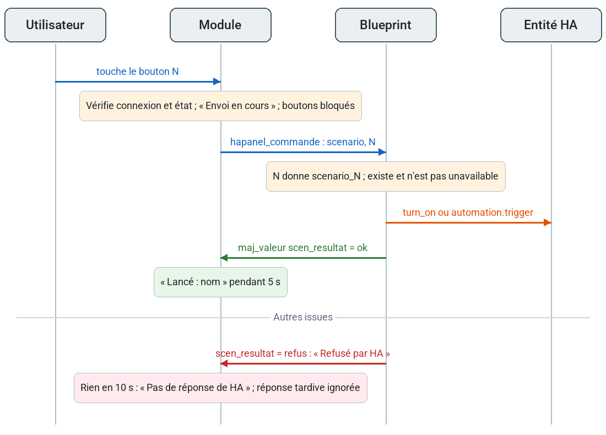

**Scénarios :** le module n'envoie qu'un numéro, et le blueprint le traduit en entité : ce
chemin ne permet de lancer que les entités choisies. `Lancé` signifie que HA a accepté
l'action, pas qu'elle a abouti (D024).

| Commande | Valeur | Conditions vérifiées par le blueprint |
|---|---|---|
| `chauffage_mode` | `heat`, `off` | État différent, non verrouillé |
| `chauffage_consigne` | Nombre | Chauffage allumé, non verrouillé, dans les bornes |
| `chauffage_prereglage` | Préréglage | Connu du thermostat, chauffage allumé, non verrouillé |
| `scenario` | Numéro de 1 à 6 | Dans la liste, entité existante et non `unavailable` |

## Navigation et interface

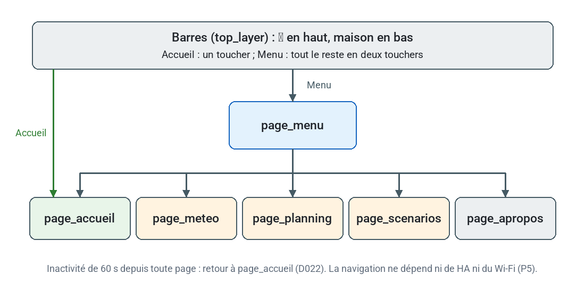

Les deux barres sont dans le `top_layer` de LVGL, donc communes à toutes les pages (D025,
D036) : en haut la barre d'état (titre, disquette ou mise à jour, Wi-Fi, point HA, bouton Menu ☰), en bas
le bouton Accueil, masqué avec sa barre sur l'accueil. Une page visible ou non reçoit ses
mises à jour de la même façon : les widgets vivent en mémoire pour toute la durée
d'exécution.

**Ajouter une page :** créer `packages/pages/<page>.yaml`, l'inclure dans `packages/application.yaml`, écrire
son titre dans `lbl_barre_titre` par son `on_load` et placer son contenu entre y = 38 et
y = 274, ajouter sa tuile dans `menu.yaml`, puis, si elle reçoit des valeurs, ajouter un préfixe dans `liaison_ha.yaml`
et un envoi dans le blueprint. Mesurer ensuite la mémoire (G6).

## Veille et retour à l'accueil

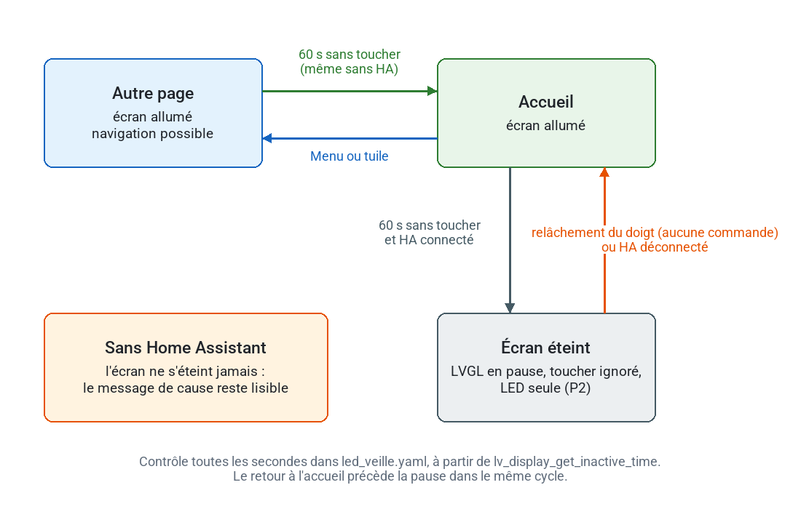

`resume_on_input` est désactivé : le module se réveille au relâchement du doigt, alors que LVGL
en pause ignore le toucher. Le geste de réveil ne peut donc pas devenir un clic (D017).

## Lumière de la pièce

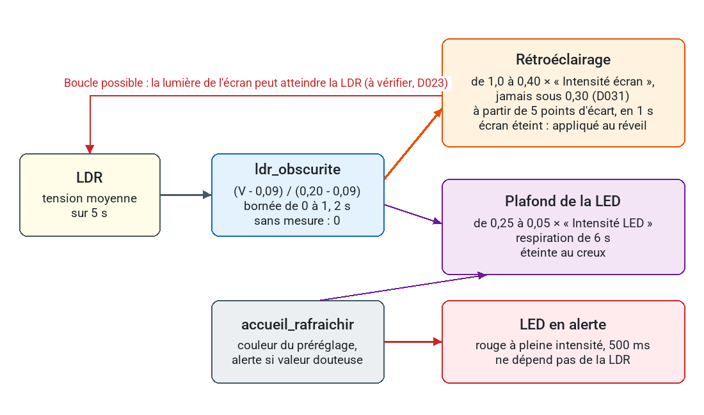

Une même grandeur, `ldr_obscurite`, pilote le rétroéclairage (D023) et la LED (D018). La LDR
distingue mal les niveaux courants : c'est en pratique un réglage jour / nuit. Son comportement
en pièce sombre et l'influence de l'écran sur la mesure restent à confirmer au banc.

**Réglages de la LED (D027) :** trois entités de configuration du module, « LED », « Intensité
LED » et « Alerte LED », gardées en flash. Elles se règlent sur la page de l'appareil dans HA
ou sont imposées par le blueprint par les clés `led_*`. `maj_valeur` les applique aux mêmes
entités, que HA affiche aussitôt, et seulement si la valeur change : pas d'écriture en flash
toutes les 5 minutes (G3).

**Réglages depuis le module (D031) :** la page `page_reglages` (`packages/pages/reglages.yaml`,
tuile du Menu) agit sur ces mêmes entités et sur une quatrième, « Intensité écran », qui
multiplie la luminosité calculée par `retro_cible_calculer` sans descendre sous
`retro_plancher`. Une seule valeur par réglage, donc pas de synchronisation à écrire : la page
écrit l'entité (au relâchement pour un curseur, une seule écriture en flash), et chaque
`on_value` d'entité appelle `reglages_rafraichir`, qui recopie les quatre valeurs sur la page
sans émettre d'événement LVGL, donc sans boucle. Le blueprint envoie chaque clé `led_*` et
`ecran_intensite`, avec `libre` quand il n'impose rien ; une valeur imposée met à vrai le
drapeau `reglage_impose_*` correspondant, et la page affiche un cadenas et désactive la
commande.

**Message d'accueil (D028, D042) :** la section « Message d'accueil » du blueprint
`module.yaml` choisit le texte et la ligne de météo, puis appelle `message_accueil` sur son
module si l'entité « Message d'accueil » est activée ; le choix dépend de l'instant du
déclenchement, donc les modules réglés de même affichent le même texte. Le module l'affiche par-dessus les deux barres,
garde l'écran allumé, passe la LED en arc-en-ciel (l'alerte reste prioritaire) et ferme le
message au toucher, après 3 minutes ou à la déconnexion de HA (P2).

## Compilation et déploiement

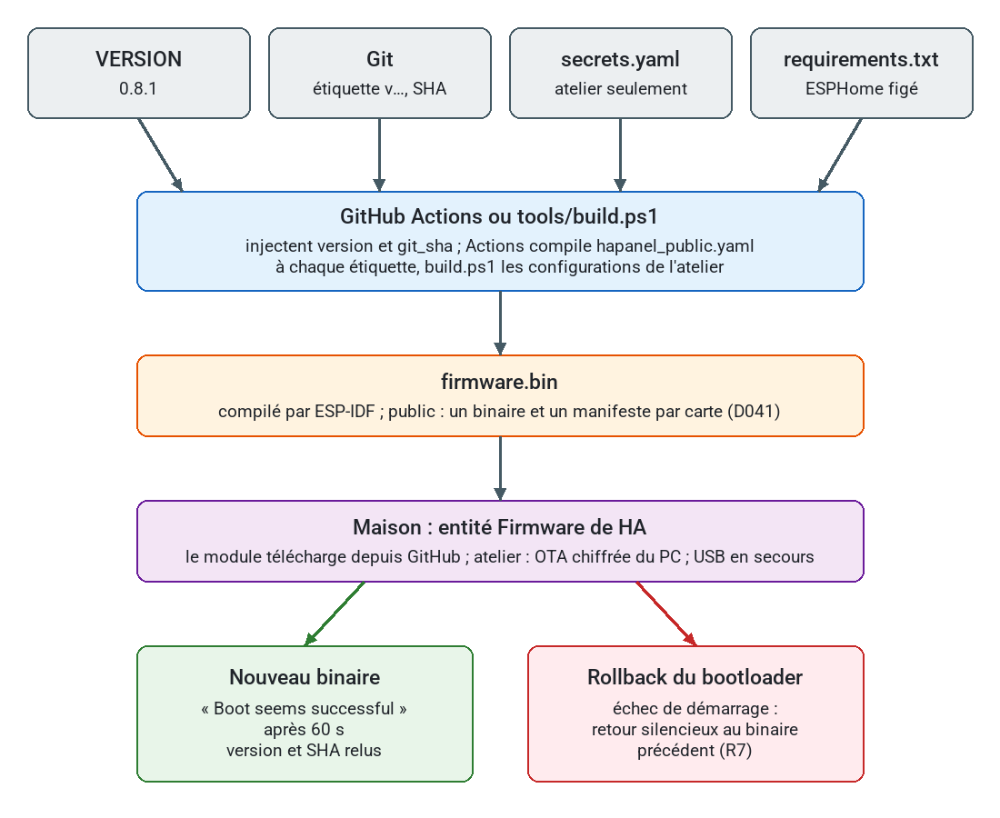

- **Identité :** GitHub Actions (binaire public) et `tools/build.ps1` (atelier) injectent `VERSION` et le SHA. Le suffixe `+modif` signale un
  binaire qui ne correspond à aucun commit et ne vaut pas validation (G5).
- **Version figée :** ESPHome est fixé par `requirements.txt` (D005).
- **Vérification :** après une OTA, relire la version et le SHA, puis attendre « Boot seems
  successful », car un échec peut ramener sans bruit au binaire précédent.
- **Blueprint :** `source_url` pointe sur `main`. Il suit Git et non le firmware : un changement de
  clés demande de mettre à jour les deux.
- **Dossier de compilation :** atelier `.esphome/build/hapanel`, banc `hapanel_banc`, public
  `hapanel_public` : passer de l'un à l'autre ne recompile pas tout.
- **Binaire public (D039), mode de déploiement de tous les modules de la maison (D037 révisée) :**
  une étiquette `v<version>` lance GitHub Actions, qui publie une Release (binaire complet, binaire
  de mise à jour, manifeste avec le résumé lu dans `NOUVEAUTES.md`) ; chaque module la propose dans
  HA (entité Firmware) et sur son écran (tuile du Menu, D047). USB en secours. Procédure : [DEPLOIEMENT_PUBLIC.md](DEPLOIEMENT_PUBLIC.md).

## Sécurité

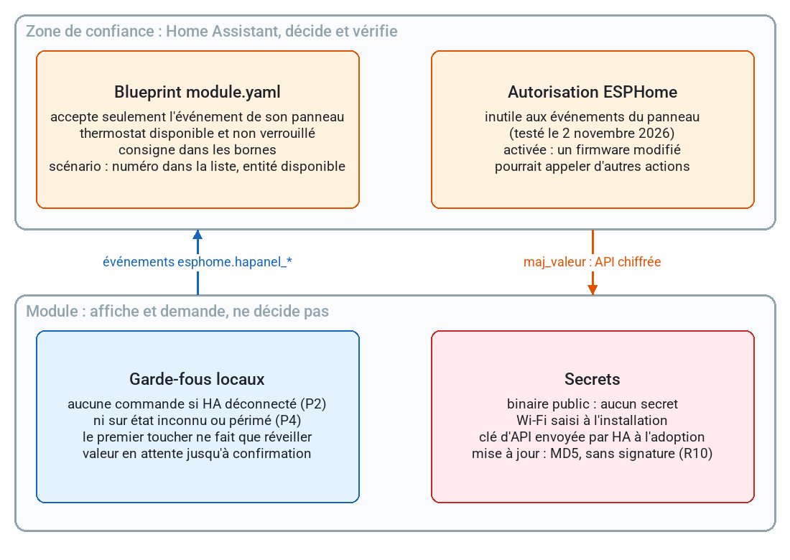

| Risque | État |
|---|---|
| Clé d'API commune aux modules de l'atelier (R8) | Accepté : la clé d'un module de test ouvre l'API et l'OTA des autres ; binaire public : une clé par module, donnée par HA |
| `maj_valeur` accessible à tout détenteur de la clé | Peut changer l'affichage, pas commander un appareil |
| Réglages de la LED modifiables depuis HA (D027) | Peuvent éteindre la LED ou son alerte ; l'écran montre toujours l'état réel |
| Message d'accueil (D028) | Texte borné à 240 octets, sans commande ; fermé à la déconnexion de HA |
| Autorisation des actions HA du module | Inutile aux événements (testé le 2 novembre 2026). Activée, elle permettrait à un firmware modifié d'appeler d'autres actions ; désactivée, il ne peut qu'émettre des événements. La liste de scénarios ne remplace pas la protection de la clé |
| Secrets dans le dépôt (R3, G9) | `secrets.yaml` est ignoré par Git |
| Binaire public (D039, R10) | Sans secret ; fenêtre d'installation de 15 min ; pas d'OTA depuis un PC ; binaire non signé : sa fiabilité repose sur le compte GitHub |
| Commande sur état inconnu (R4) | Refus côté module et côté blueprint |

Toute nouvelle surface s'inscrit dans [08_RISKS_AND_DEBT.md](codex/08_RISKS_AND_DEBT.md) avant fusion.

## Mémoire

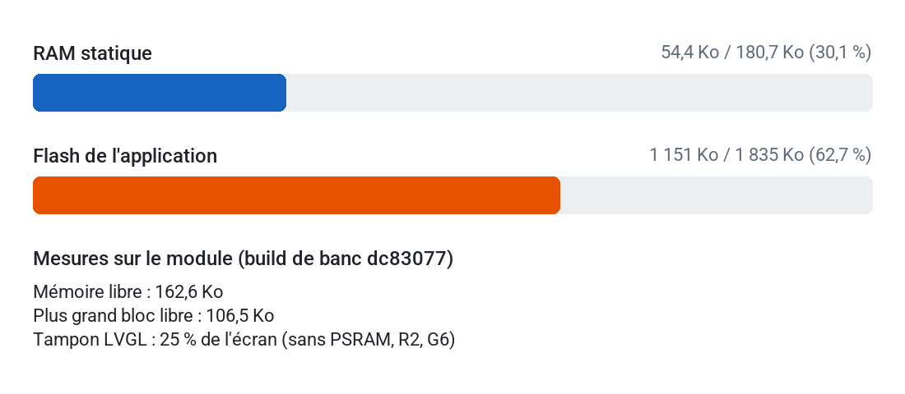

Sans PSRAM, la mémoire est la principale limite (R2). Chaque glyphe de police occupe de la flash,
d'où des listes de glyphes limitées : c'est pourquoi les scénarios proposent 25 icônes et non toute la
police (D026). Mesurer la mémoire libre et le plus grand bloc à chaque palier (G6).

## Limites connues

- **Tests :** il n'y a pas de test automatisé. La validation se fait au banc, et plusieurs états
  dégradés restent à confirmer (`docs/TODO.md`).
- **Latence des scénarios :** noms et disponibilité ne sont rafraîchis que toutes les 5 min.
- **Changement d'heure :** la frise du planning est décalée ce jour-là (D020).
- **Duplication :** `scenarios.yaml` répète six fois le même bouton, car ESPHome n'a pas de boucle
  de widgets simple.
- **Liste d'icônes :** elle existe dans le blueprint et dans `scenarios.yaml`, à garder alignée.

## Pour aller plus loin

| Sujet | Document |
|---|---|
| Invariants | [03_INVARIANTS.md](codex/03_INVARIANTS.md) |
| Règles de développement | [04_DEVELOPMENT_RULES.md](codex/04_DEVELOPMENT_RULES.md) |
| Compilation et tests | [05_BUILD_AND_TEST.md](codex/05_BUILD_AND_TEST.md) |
| Utilisation et configuration | [UTILISATION.md](UTILISATION.md), [CONFIGURATION.md](CONFIGURATION.md) |

Les schémas se régénèrent avec `tools/generer_schemas_architecture.py`.
