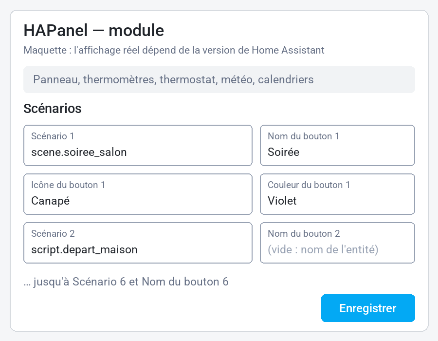
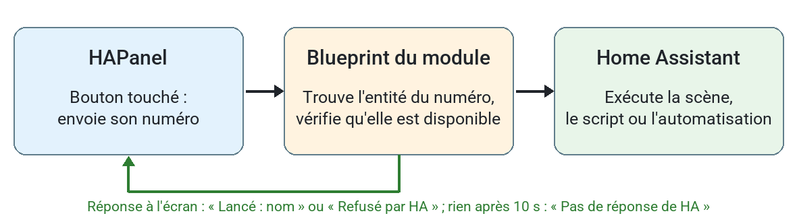

# Configurer HAPanel

Ce document s'adresse à la personne qui administre Home Assistant. Il décrit le
raccordement d'un module déjà installé, le choix de ce qu'il affiche et les réglages
disponibles. L'usage au quotidien est décrit dans [UTILISATION.md](UTILISATION.md).

*Les images sont des maquettes : les écrans de Home Assistant peuvent différer selon
sa version.*

## Principe

Chaque module utilise le même logiciel et ne connaît aucune entité de votre maison.
Tout se choisit dans Home Assistant, avec **un blueprint et une automatisation par
module** : 5 modules, 5 automatisations. Seul le message d'accueil a son propre
blueprint, avec une automatisation pour toute la maison (section 6).

## 1. Ajouter le module

**Avant de commencer**, il faut :

- **le module :** compilé, téléversé et relié au Wi-Fi (voir
  [Compiler et téléverser](#compiler-et-téléverser)) ;
- **la clé de chiffrement de l'API :** la valeur `api_encryption_key` de
  `secrets.yaml`, demandée à l'ajout ;
- **dans Home Assistant, les entités que le module affichera :**
  - un thermostat (`climate`, modes `heat` et `off`) ;
  - les capteurs de température de la pièce et de l'extérieur ;
  - une météo (`weather`) avec prévisions quotidiennes ;
  - 1 à 4 calendriers ;
  - en option, des scènes, scripts ou automatisations pour la page Scénarios.

**Ajouter le module :**

1. **Paramètres › Appareils et services.** Le module découvert apparaît sous
   « Nouveaux appareils découverts » : **Ajouter**.
2. Sinon : **Ajouter une intégration › ESPHome**, puis l'adresse IP du module (port
   6053).
3. Saisir la clé de chiffrement de l'API.

L'option « Autoriser l'appareil à effectuer des actions Home Assistant » **n'est pas
nécessaire** : le module n'envoie que des événements (demande de valeurs, commandes),
que Home Assistant reçoit sans elle (testé le 2 novembre 2026). La laisser désactivée
réduit ce qu'un module modifié pourrait faire dans Home Assistant.

## 2. Importer le blueprint

**Paramètres › Automatisations et scènes › Blueprints › Importer un blueprint**, puis
collez ce lien :

```
https://github.com/cnuma/HAPanel/blob/main/blueprints/automation/hapanel/module.yaml
```

Pour une mise à jour : menu **⋮** du blueprint, puis **Réimporter le blueprint**.

## 3. Créer l'automatisation du module

Créez une automatisation depuis **HAPanel — module**, une seule par module. Deux
automatisations sur le même module exécuteraient chaque commande deux fois.

| Champ | À choisir | Remarque |
|---|---|---|
| Panneau | Le module HAPanel | |
| Thermomètre | Capteur de température de la pièce | |
| Thermomètre extérieur | Capteur de température extérieure | |
| Thermostat | Entité `climate` | Modes `heat` et `off` |
| Consigne minimale / maximale | Bornes de réglage | 15 et 25 °C par défaut ; resserrées à celles du thermostat |
| Météo | Entité `weather` | Doit fournir des prévisions quotidiennes |
| Calendriers | 1 à 4 entités `calendar` | Le premier est le principal |
| Scénarios | Voir ci-dessous | Facultatif ; section repliée |

Les préréglages affichés sont `none`, `frost`, `eco`, `comfort` et `boost`. Un
préréglage que le thermostat ne connaît pas est refusé.

Dans le nom d'un calendrier, le mot « Chauffage » est retiré à l'affichage.

**Vérifier le raccordement :**

1. Enregistrer l'automatisation. Les valeurs arrivent au plus tard 5 minutes après,
   ou aussitôt après une reconnexion du module : **Paramètres › Appareils et
   services › ESPHome**, menu **⋮** du module, **Recharger**.
2. Sur le module, page **À propos** : « Home Assistant : connecté ».
3. Sur l'accueil : températures, préréglage et consigne affichés, sans « non reçu ».
4. Changer la consigne sur le module : 2 secondes après le dernier toucher, le
   thermostat suit dans Home Assistant. Sans confirmation en 10 secondes, le module
   revient à l'ancienne valeur.
5. Pages Météo, Planning et Scénarios : valeurs présentes. Lancer un scénario sans
   conséquence pour vérifier le retour « Lancé ».
6. En cas de « non reçu » persistant : menu **⋮** de l'automatisation, **Traces**,
   puis le [Dépannage](#dépannage).

## 4. Choisir les scénarios



- **Six groupes de champs :** chaque numéro correspond à une place fixe sur la page.
- **Scénario :** une scène, un script ou une automatisation.
- **Nom du bouton :** facultatif, 24 caractères au plus. Laissé vide, le bouton porte
  le nom de l'entité.
- **Icône :** facultative, à choisir dans la liste. Avec une icône, le nom tient sur
  2 lignes au plus ; la suite est coupée.
- **Couleur :** à choisir dans la liste ; bleu par défaut. Toutes restent lisibles avec
  un texte blanc.
- **Place vide :** un scénario non renseigné laisse un trou dans la grille.

Ajouter une icône ou une couleur à la liste demande de modifier le blueprint et
`packages/pages/scenarios.yaml`, puis de recompiler le module.

Une automatisation est lancée **sans vérifier ses conditions**, comme avec « Exécuter »
dans Home Assistant. Il n'y a pas de confirmation à l'écran : évitez d'y mettre une
action sensible.



Le bouton n'envoie qu'un numéro : ce chemin ne lance que les entités choisies ici.
Protégez aussi la clé d'API : avec elle, un module modifié pourrait émettre d'autres
événements.

## 5. Régler la LED

Chaque module a trois réglages, sur sa page d'appareil (**Paramètres › Appareils et
services › ESPHome**, le module, rubrique **Configuration**) :

| Réglage | Valeurs | Par défaut |
|---|---|---|
| LED | Respiration, Éteinte | Respiration |
| Intensité LED | 0 à 100 % ; 100 % est le maximum | 20 % |
| Alerte LED | Activée, désactivée : clignotement rouge en cas d'anomalie | Activée |

L'effet est immédiat et le module garde ses réglages après un redémarrage, même sans
Home Assistant. L'intensité baisse d'elle-même dans une pièce sombre. Alerte
désactivée, une anomalie ne se voit plus que sur l'écran.

La section **LED** du blueprint, repliée, propose les mêmes réglages, sur « Ne pas
imposer » par défaut. Une valeur choisie dans le blueprint est envoyée au module à la
connexion et toutes les 5 minutes : elle **l'emporte** sur la page de l'appareil, où un
changement est remplacé sous 5 minutes. Pour régler depuis la page de l'appareil,
laissez « Ne pas imposer ».

## 6. Message d'accueil

Quand quelqu'un arrive après une absence, les modules affichent un message pendant
3 minutes, LED en arc-en-ciel. La croix en haut à droite, ou un toucher ailleurs, le
ferme.

**Une seule automatisation pour toute la maison**, depuis un second blueprint.

### Avant de commencer

- **Modules :** un logiciel qui comprend le message d'accueil (D028) ; chaque module
  a alors une entité **Message d'accueil** dans sa rubrique **Configuration**.
- **Déclencheurs :** au moins une entité qui passe à « on » à l'arrivée : contact de
  la porte d'entrée, lumière de l'entrée, interrupteur.
- **Facultatif :** une liste de messages, une liste de messages uniques et une entité
  `weather` pour la météo sous le message.

### Créer les listes de messages (facultatif)

Sans liste, le module affiche « Bonjour » ou « Bonsoir, bienvenue à la maison ! ».

1. **Paramètres › Appareils et services › Ajouter une intégration**, puis **Liste de
   tâches locale**. Nom : « Messages d'accueil ».
2. **Paramètres › Appareils et services › Entités** : vérifier que l'entité créée est
   `todo.messages_d_accueil`.
3. Remplir la liste :
   - **d'un coup :** le script
     [exemples/messages_accueil.yaml](exemples/messages_accueil.yaml) ajoute
     27 messages. **Paramètres › Automatisations et scènes › Scripts › Créer un
     script**, menu **⋮ › Modifier en YAML**, remplacer tout le contenu par le
     fichier, enregistrer, puis **Exécuter** une seule fois : chaque exécution
     ajoute de nouveau les 27 messages. Supprimer ensuite le script. Si l'entité de
     l'étape 2 est différente, corriger `entity_id` dans le script avant de
     l'exécuter ;
   - **à la main :** **Listes de tâches** dans la barre latérale, la liste, puis
     **Ajouter une tâche**.
4. Pour des messages uniques, créer de la même façon une seconde liste, par exemple
   « Messages uniques ».

**Écrire les messages.** Chaque tâche non cochée est un message. Dans sa description,
des mots le réservent à une saison (printemps, été, automne, hiver) ou à un moment
(matin, après-midi, soir, nuit) ; sans ces mots, il convient toujours. Un message est
tiré au hasard parmi ceux qui conviennent. Cochez une tâche pour la mettre de côté.
Les textes longs sont coupés : visez 100 caractères au plus.

**Messages uniques.** Dans la seconde liste, la première tâche non cochée passe avant
tout le reste, puis le blueprint la coche : elle ne s'affiche qu'une fois.

### Importer le blueprint

**Paramètres › Automatisations et scènes › Blueprints › Importer un blueprint**, puis
collez ce lien :

```
https://github.com/cnuma/HAPanel/blob/main/blueprints/automation/hapanel/message_accueil.yaml
```

Pour une mise à jour : menu **⋮** du blueprint, puis **Réimporter le blueprint**.

### Créer l'automatisation

Créez **une seule** automatisation depuis **HAPanel — message d'accueil**, pour toute
la maison.

| Champ | À choisir | Par défaut |
|---|---|---|
| Panneaux | Les modules qui affichent le message | |
| Déclencheurs | Contacts de porte, lumières, interrupteurs : l'arrivée est leur passage à « on » | |
| Période sans déclenchement | Aucun déclencheur ne doit avoir changé pendant ce temps | 30 min |
| Accueil à partir de / jusqu'à | Plage horaire ; elle peut passer minuit | 6 h à 23 h |
| Liste des messages | Liste de tâches de HA | Facultatif |
| Liste des messages uniques | Liste de tâches de HA, prioritaire | Facultatif |
| Météo | Entité `weather` : « Dehors : 12 °C, nuageux » sous le message | Facultatif |

### Comment le message se déclenche

Le message part quand un déclencheur passe de « off » à « on » (pour un contact de
porte : l'ouverture) et que :

1. l'heure est dans la plage choisie ;
2. ce déclencheur était au repos depuis la période choisie (30 min par défaut) ;
3. aucun autre déclencheur n'est à « on » ni n'a changé pendant cette période : la
   maison était inoccupée ;
4. au moins un module est connecté, avec son entité « Message d'accueil » activée.

Un passage par « indisponible » ne déclenche rien. Après un redémarrage de Home
Assistant, l'accueil attend la période choisie.

**Choisir les déclencheurs.** Le blueprint ne distingue pas une arrivée d'un départ :
avec le seul contact de porte, une personne restée à la maison plus de 30 min qui sort
voit le message. Ajouter les lumières principales réduit ces cas : si l'une est
allumée ou a changé pendant la période, la maison est jugée occupée. Chaque entité
ajoutée peut en revanche déclencher le message elle-même. Éviter les détecteurs de
mouvement : une personne immobile 30 min verrait le message à son premier geste.

**Capteur en panne.** Un contact de porte dont la pile est morte peut garder son
dernier état sans rien signaler (Z-Wave sur pile notamment) : l'accueil ne se
déclenche plus jamais. Le blueprint
[HASurveillance](https://github.com/cnuma/HASurveillance) détecte ces pannes.

### Vérifier

1. **Affichage :** menu **⋮** de l'automatisation, **Exécuter les actions**. Le
   déclencheur et les conditions sont sautés : le message part aussitôt vers les
   modules connectés.
2. **Chaîne complète :** régler la période à 5 minutes, laisser les déclencheurs au
   repos 5 minutes, puis ouvrir la porte. Remettre ensuite la période voulue.
3. **Si rien ne s'affiche :** menu **⋮** de l'automatisation, **Traces** : la trace
   indique la condition qui a bloqué.

### Par module

L'entité **Message d'accueil**, rubrique **Configuration** de la page de l'appareil,
désactive l'accueil sur ce module (une chambre par exemple). La LED suit les réglages
« LED » et « Intensité LED ».

## Quand les changements arrivent

| Événement | Délai |
|---|---|
| Changement de température, de thermostat ou de météo | Immédiat |
| Événement de calendrier modifié à l'avance | 5 minutes au plus |
| Nom ou disponibilité d'un scénario | 5 minutes au plus, ou à la reconnexion |
| Redémarrage du module ou de Home Assistant | Renvoi complet à la connexion |

Sans nouvelle valeur pendant 15 minutes, le module affiche la valeur comme périmée.

## Réglages du logiciel

Ces valeurs sont lues à la compilation : après un changement, il faut recompiler et
téléverser le module.

| Réglage | Fichier | Valeur | Effet |
|---|---|---|---|
| `veille_delai_ms` | `packages/led_veille.yaml` | 60000 | Retour à l'accueil et écran éteint sans toucher |
| `retro_jour` | `packages/led_veille.yaml` | 1.0 | Luminosité de l'écran, pièce éclairée |
| `retro_nuit` | `packages/led_veille.yaml` | 0.40 | Luminosité, pièce sombre (après gamma : environ 8 %) |
| `retro_ecart_min` | `packages/led_veille.yaml` | 0.05 | Écart minimal avant de changer la luminosité |
| `led_plafond_jour` / `led_plafond_nuit` | `packages/led_veille.yaml` | 0.25 / 0.05 | Intensité de la LED à 100 % du réglage « Intensité LED » |
| `led_intensite_defaut` | `packages/led_veille.yaml` | 20 | « Intensité LED » d'un module neuf |
| `ldr_tension_jour` / `ldr_tension_nuit` | `packages/led_veille.yaml` | 0.09 / 0.20 | Tensions qui définissent pièce éclairée et pièce sombre |
| `accueil_envoi_consigne` | `packages/pages/accueil.yaml` | 2s | Attente avant l'envoi de la consigne |
| `accueil_attente_confirmation` | `packages/pages/accueil.yaml` | 10s | Attente de la confirmation du chauffage |
| `scenarios_attente_ms` | `packages/pages/scenarios.yaml` | 10000 | Attente de la réponse à un scénario |
| `scenarios_message_ms` | `packages/pages/scenarios.yaml` | 5000 | Durée d'affichage du résultat |
| `liaison_peremption_ms` | `packages/liaison_ha.yaml` | 900000 | Délai avant « périmé » |
| `message_duree_ms` | `packages/message_accueil.yaml` | 180000 | Durée d'affichage du message d'accueil |
| `led_arc_periode_ms` | `packages/led_veille.yaml` | 2000 | Un tour de l'arc-en-ciel |

La lumière de la pièce est lue par un capteur peu précis : attendez-vous plutôt à un
réglage jour / nuit qu'à une variation fine.

### Compiler et téléverser

Depuis la racine du dépôt, sous PowerShell, avec `secrets.yaml` créé d'après
`secrets.example.yaml` :

```powershell
.\.venv\Scripts\Activate.ps1
.\tools\build.ps1 run -Config hapanel.yaml -Device <IP_DU_MODULE>
```

Préférez un bloc secteur de 1 A : le port USB d'un PC peut provoquer des redémarrages.
La procédure complète est dans [05_BUILD_AND_TEST.md](codex/05_BUILD_AND_TEST.md).

### Régénérer les images de la documentation

Après une compilation, qui fournit les polices :

```powershell
.\.venv\Scripts\python tools\generer_images_doc.py
```

## Dépannage

| Symptôme | Cause probable | Que faire |
|---|---|---|
| « non reçu » partout, point vert | Automatisation absente, désactivée ou incomplète | Vérifier l'automatisation du module et ses traces |
| Commandes sans effet, valeurs lentes à la connexion | Automatisation absente, désactivée ou pour un autre panneau | Vérifier le champ Panneau de l'automatisation et ses traces |
| Chaque commande s'exécute deux fois | Deux automatisations pour le module | En supprimer une |
| Page Scénarios sur « non reçus » | Ancienne version du blueprint | Réimporter, puis redémarrer le module |
| « Aucun scénario choisi » | Champs vides | Remplir la section Scénarios et enregistrer |
| « Refusé par HA » | Entité indisponible ou supprimée | Vérifier l'entité ; voir aussi le journal de Home Assistant (`hapanel.blueprint`) |
| « Pas de réponse de HA » | Automatisation absente ou action en échec | Consulter les traces de l'automatisation |
| Réglage de la LED qui revient tout seul | Valeur imposée par le blueprint | Choisir « Ne pas imposer » dans la section LED, ou régler dans le blueprint |
| Pas de message d'accueil | Période sans déclenchement non écoulée, hors plage horaire, entité « Message d'accueil » désactivée ou module déconnecté | Consulter les traces de l'automatisation du message d'accueil |
| Écran trop sombre la nuit | `retro_nuit` trop bas | Augmenter la valeur et recompiler |
| Point rouge et « Pas de communication » | Home Assistant arrêté, module retiré ou clé d'API différente | Vérifier l'intégration ESPHome |
