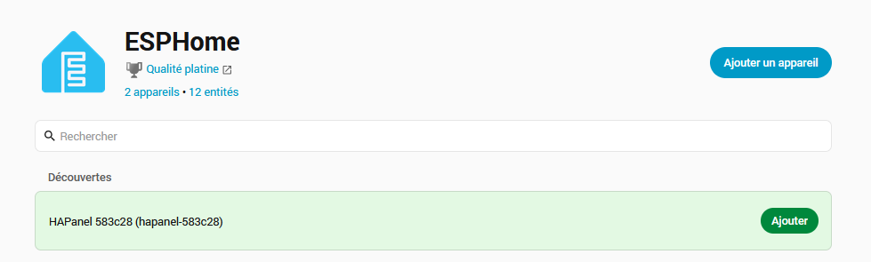
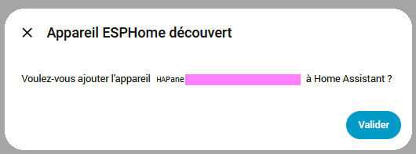
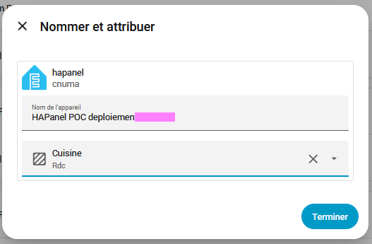
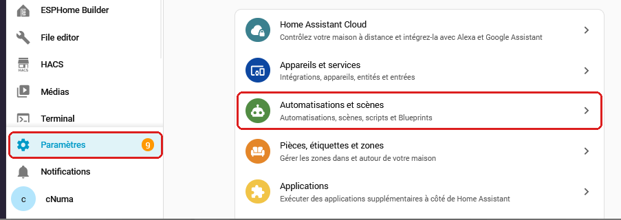
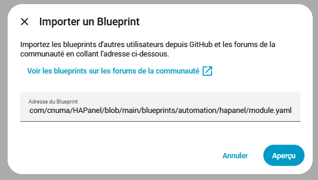
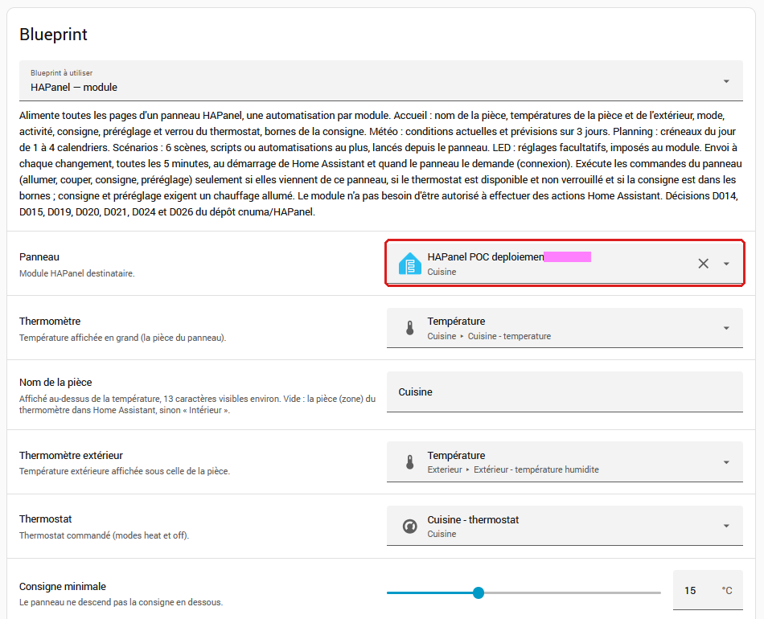
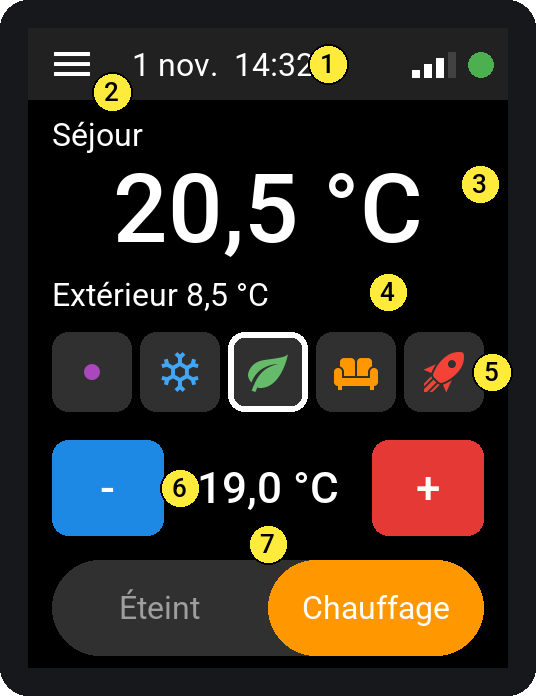
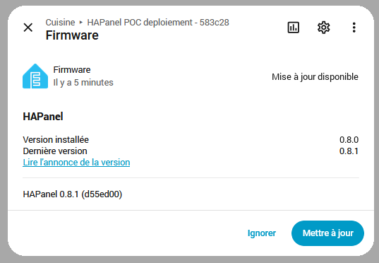

# Configurer HAPanel dans Home Assistant

Ce guide relie un module HAPanel à Home Assistant et choisit ce qu'il affiche. Il
suit le guide [INSTALLATION.md](INSTALLATION.md) : le module doit déjà être relié à
votre Wi-Fi. Comptez 15 minutes. L'usage au quotidien est dans
[UTILISATION.md](UTILISATION.md).

**Rien à compiler, rien à téléverser :** le logiciel du module est un fichier tout
prêt, publié dans la rubrique **Releases** du dépôt GitHub, et Home Assistant
installe seul les versions suivantes (section 7).

*Les écrans de Home Assistant peuvent différer légèrement selon sa version.*

## Le principe en deux phrases

Le module ne connaît rien de votre maison : c'est Home Assistant qui lui dit quoi
afficher. Pour cela, on importe **une fois** le « blueprint » HAPanel (un modèle
d'automatisation), puis on crée **une automatisation par module** à partir de ce
modèle : 3 modules, 3 automatisations.

## Avant de commencer

Vérifiez que Home Assistant contient déjà les entités que le module affichera :

| Pour | Il faut dans Home Assistant | Obligatoire |
|---|---|---|
| La température de la pièce | Un capteur de température | Oui |
| La température dehors | Un second capteur de température | Oui |
| Le chauffage | Un thermostat (entité `climate.…`) avec les modes « Chauffage » et « Éteint » | Oui |
| La page Météo | Une entité météo (`weather.…`) avec prévisions par jour | Oui |
| La page Planning | 1 à 4 calendriers (`calendar.…`) | Oui |
| La page Scénarios | Des scènes, scripts ou automatisations | Non |

## 1. Ajouter le module

1. Ouvrez Home Assistant, puis **Paramètres › Appareils et services**.
2. En haut, parmi les appareils découverts, le module apparaît sous le nom
   **HAPanel** suivi de six caractères, par exemple « HAPanel 1a2b3c
   (hapanel-1a2b3c) » : cliquez sur **Ajouter**. Si vous avez déjà un appareil
   ESPHome, il peut aussi apparaître en ouvrant **ESPHome**, rubrique
   **Découvertes** (capture ci-dessous).



3. Cliquez sur **Valider**. **Aucune clé n'est à saisir** : Home Assistant crée
   lui-même la clé qui chiffre les échanges et l'envoie au module.



4. Dans « Nommer et attribuer », gardez ou changez le nom, choisissez la pièce du
   module, puis **Terminer**.



5. Regardez le module : le point en haut à droite passe au **vert** et « Pas de
   communication avec Home Assistant » disparaît. L'écran affiche encore « non
   reçu » : c'est normal, il ne sait pas encore quoi afficher.

**Le module n'apparaît pas :** attendez 2 minutes après l'avoir branché, puis
actualisez la page. Toujours rien : cliquez sur **Ajouter une intégration**,
cherchez **ESPHome**, puis saisissez l'adresse IP du module (votre box la donne,
dans sa liste des appareils connectés).

**Home Assistant demande une clé :** ne saisissez rien et voyez le
[Dépannage](#dépannage).

**À ne pas cocher :** « Autoriser l'appareil à effectuer des actions Home
Assistant ». Le module n'en a pas besoin ; laissée décochée, l'option limite ce
qu'un module modifié pourrait faire.

**Module déjà ajouté :** vérifiez l'option une fois.

1. **Paramètres › Appareils et services › ESPHome**.
2. Sur la ligne du module, cliquez sur **⚙ Configurer** (ou **⋮ › Options**).
3. Décochez « Autoriser l'appareil à effectuer des actions Home Assistant », puis
   **Valider**.
4. Sur le module, réglez la consigne de l'accueil et lancez un scénario : les deux
   marchent toujours (ils n'utilisent pas cette option).

Pourquoi : un module dont on aurait modifié le logiciel pourrait, avec l'option,
lancer n'importe quelle action de Home Assistant (serrures, alarme…). Sans elle, il
ne peut que ce que le blueprint permet (`docs/codex/02_DECISIONS.md`, D046).

## 2. Importer le blueprint

À faire **une seule fois**, quel que soit le nombre de modules.

1. **Paramètres › Automatisations et scènes**, onglet **Blueprints**.



2. En bas à droite, **Importer un blueprint**.
3. Collez ce lien dans **Adresse du Blueprint**, cliquez sur **Aperçu**, puis
   confirmez l'importation sous l'aperçu :

   ```
   https://github.com/cnuma/HAPanel/blob/main/blueprints/automation/hapanel/module.yaml
   ```



4. Le blueprint **HAPanel — module** apparaît dans la liste.

## 3. Créer l'automatisation du module

À faire **pour chaque module**, une seule fois par module : deux automatisations
pour le même module exécuteraient chaque commande deux fois.

1. Onglet **Blueprints**, cliquez sur **HAPanel — module**. Un formulaire s'ouvre.
2. Remplissez les champs, de haut en bas :

   | Champ | Que choisir |
   |---|---|
   | Panneau | Votre module (son nom commence par HAPanel) |
   | Thermomètre | Le capteur de température de la pièce |
   | Nom de la pièce | Facultatif : le texte au-dessus de la température, 14 caractères au plus. Vide : le nom de la pièce du thermomètre dans Home Assistant |
   | Thermomètre extérieur | Le capteur de température dehors |
   | Thermostat | Le thermostat de la pièce |
   | Consigne minimale / maximale | Laissez 15 et 25 °C, sauf besoin particulier |
   | Météo | Votre entité météo |
   | Calendriers | 1 à 4 calendriers ; le premier est le principal |
   | Scénarios, LED et écran, Message d'accueil | Facultatif, sections repliées : sections 4, 5 et 6 ci-dessous |



3. **Enregistrer**, puis donnez un nom, par exemple « HAPanel cuisine ».
4. Regardez le module : en quelques secondes, l'accueil affiche vos températures et
   votre chauffage.



**Vérifier que tout fonctionne :**

1. Touchez **+** ou **−** sur l'accueil : 2 secondes après, la consigne du
   thermostat change dans Home Assistant. Sans réponse en 10 secondes, le module
   revient à l'ancienne valeur.
2. Ouvrez les pages **Météo** et **Planning** (bouton ☰ en haut à gauche) : elles
   affichent vos valeurs.
3. Toujours « non reçu » après 5 minutes : voyez le [Dépannage](#dépannage).

Bon à savoir : le mot « Chauffage » est retiré du nom des calendriers à
l'affichage. Le module propose les préréglages Manuel, Hors-gel, Éco, Confort et
Boost ; si votre thermostat ne connaît pas l'un d'eux, il le refuse.

## 4. Choisir les scénarios


- **Six groupes de champs :** chaque numéro correspond à une place fixe sur la page.
- **Scénario :** une scène, un script ou une automatisation.
- **Nom du bouton :** facultatif, 24 caractères au plus. Laissé vide, le bouton porte
  le nom de l'entité.
- **Icône :** facultative, à choisir dans la liste. Avec une icône, le nom tient sur
  2 lignes au plus ; la suite est coupée.
- **Couleur :** à choisir dans la liste ; bleu par défaut. Toutes restent lisibles avec
  un texte blanc.
- **Place vide :** un scénario non renseigné laisse un trou dans la grille.

Une automatisation est lancée **sans vérifier ses conditions**, comme avec « Exécuter »
dans Home Assistant. Il n'y a pas de confirmation à l'écran : évitez d'y mettre une
action sensible.


Le bouton n'envoie qu'un numéro : il ne peut lancer que les scénarios choisis ici.

## 5. Régler la LED et l'écran

Chaque module a quatre réglages, à deux endroits qui montrent toujours la même
valeur :

- sa page d'appareil dans Home Assistant (**Paramètres › Appareils et services ›
  ESPHome**, le module, rubrique **Configuration**) ;
- sa page **Réglages**, sur l'écran : **Menu › Réglages** (D031).

| Réglage | Valeurs | Par défaut |
|---|---|---|
| LED | Respiration, Éteinte | Respiration |
| Intensité LED | 0 à 100 % ; 100 % est le maximum | 20 % |
| Alerte LED | Activée, désactivée : clignotement rouge en cas d'anomalie | Activée |
| Intensité écran | 20 à 100 % : multiplie la luminosité choisie selon la pièce | 100 % |

L'effet est immédiat et le module garde ses réglages après un redémarrage, même sans
Home Assistant. L'intensité de la LED et celle de l'écran baissent d'elles-mêmes dans
une pièce sombre ; l'écran ne descend jamais sous un plancher lisible. Alerte
désactivée, une anomalie ne se voit plus que sur l'écran.

La section **LED et écran** du blueprint, repliée, propose les mêmes réglages, sur
« Ne pas imposer » par défaut. Une valeur choisie dans le blueprint est envoyée au
module à la connexion et toutes les 5 minutes : elle **l'emporte** sur la page de
l'appareil, où un changement est remplacé sous 5 minutes. Sur la page Réglages de
l'écran, elle porte un **cadenas** et ne réagit pas ; un cadenas suivi de « imposé
par HA » le rappelle en bas de la page. Pour régler depuis
la page de l'appareil ou depuis l'écran, laissez « Ne pas imposer ».

Après une mise à jour du module, réimportez le blueprint (section 7) : sans cela,
la page Réglages peut ne pas savoir quels réglages sont libres.

## 6. Message d'accueil

Quand quelqu'un arrive après une absence, les modules affichent un message pendant
3 minutes, LED en arc-en-ciel. La croix en haut à droite, ou un toucher ailleurs, le
ferme.

Il se règle dans la section repliée **Message d'accueil** du blueprint du module
(section 3), **pour chaque module** qui doit l'afficher. Chaque module décide seul ;
avec les mêmes réglages, tous les modules affichent le même message.

### Avant de commencer

- **Modules :** un logiciel qui comprend le message d'accueil (D028) ; chaque module
  a alors une entité **Message d'accueil** dans sa rubrique **Configuration**.
- **Déclencheurs :** au moins une entité qui passe à « on » à l'arrivée : contact de
  la porte d'entrée, lumière de l'entrée, interrupteur.
- **Facultatif :** une liste de messages, une liste de messages uniques et une entité
  `weather` pour la météo sous le message.

### Créer les listes de messages (facultatif)

Sans liste, le module affiche « Bonjour » ou « Bonsoir, bienvenue à la maison ! ».

1. **Paramètres › Appareils et services › Ajouter une intégration**, puis **Liste de
   tâches locale**. Nom : « Messages d'accueil ».
2. **Paramètres › Appareils et services › Entités** : vérifier que l'entité créée est
   `todo.messages_d_accueil`.
3. Remplir la liste :
   - **d'un coup :** le script
     [exemples/messages_accueil.yaml](exemples/messages_accueil.yaml) ajoute
     27 messages. **Paramètres › Automatisations et scènes › Scripts › Créer un
     script**, menu **⋮ › Modifier en YAML**, remplacer tout le contenu par le
     fichier, enregistrer, puis **Exécuter** une seule fois : chaque exécution
     ajoute de nouveau les 27 messages. Supprimer ensuite le script. Si l'entité de
     l'étape 2 est différente, corriger `entity_id` dans le script avant de
     l'exécuter ;
   - **à la main :** **Listes de tâches** dans la barre latérale, la liste, puis
     **Ajouter une tâche**.
4. Pour des messages uniques, créer de la même façon une seconde liste, par exemple
   « Messages uniques ».

**Écrire les messages.** Chaque tâche non cochée est un message. Dans sa description,
des mots le réservent à une saison (printemps, été, automne, hiver) ou à un moment
(matin, après-midi, soir, nuit) ; sans ces mots, il convient toujours. Un message est
choisi parmi ceux qui conviennent, d'après l'instant de l'arrivée : le choix paraît
fait au hasard, mais il est le même sur tous les modules. Le même message peut
revenir deux fois de suite. Cochez une tâche pour la mettre de côté.
Les textes longs sont coupés : visez 100 caractères au plus.

**Messages uniques.** Dans la seconde liste, la première tâche non cochée passe avant
tout le reste, puis l'automatisation la coche : elle ne s'affiche qu'une fois.
Avec plusieurs modules, un module occupé à ce moment (envoi de ses valeurs) peut lire
la liste après qu'un autre l'a cochée : il affiche alors le message unique suivant, et
le coche aussi. Mettre un seul message unique à la fois évite ce cas.

### Remplir la section du module

Dans l'automatisation du module (section 3), ouvrez la section **Message d'accueil**,
puis enregistrez. À refaire dans l'automatisation de chaque module qui doit afficher
le message.

| Champ | À choisir | Par défaut |
|---|---|---|
| Déclencheurs | Contacts de porte, lumières, interrupteurs : l'arrivée est leur passage à « on ». Vide : pas de message sur ce module | Vide |
| Période sans déclenchement | Aucun déclencheur ne doit avoir changé pendant ce temps | 30 min |
| Accueil à partir de / jusqu'à | Plage horaire ; elle peut passer minuit | 6 h à 23 h |
| Liste des messages | Liste de tâches de HA | Facultatif |
| Liste des messages uniques | Liste de tâches de HA, prioritaire | Facultatif |
| Météo sous le message | « Dehors : 12 °C, nuageux », d'après le champ Météo du module | Activée |

### Venir de l'ancien blueprint « HAPanel — message d'accueil »

Jusqu'au 7 novembre 2026, le message avait son propre blueprint, une automatisation
pour toute la maison. Il est retiré du dépôt (D042). Une seule fois :

1. Notez les réglages de l'automatisation « HAPanel — message d'accueil »
   (déclencheurs, période, plage, listes), puis **supprimez-la**.
2. Réimportez le blueprint du module (section 7, « Réimporter le blueprint »).
3. Dans l'automatisation de chaque module, remplissez la section **Message
   d'accueil** avec ces réglages, puis enregistrez.
4. **Paramètres › Automatisations et scènes › Blueprints** : menu **⋮** de
   **HAPanel — message d'accueil**, **Supprimer le blueprint**.

### Comment le message se déclenche

Le message part quand un déclencheur passe de « off » à « on » (pour un contact de
porte : l'ouverture) et que :

1. l'heure est dans la plage choisie ;
2. ce déclencheur était au repos depuis la période choisie (30 min par défaut) ;
3. aucun autre déclencheur n'est à « on » ni n'a changé pendant cette période : la
   maison était inoccupée ;
4. le module est connecté, avec son entité « Message d'accueil » activée.

Un passage par « indisponible » ne déclenche rien. Après un redémarrage de Home
Assistant, l'accueil attend la période choisie.

**Choisir les déclencheurs.** Le blueprint ne distingue pas une arrivée d'un départ :
avec le seul contact de porte, une personne restée à la maison plus de 30 min qui sort
voit le message. Ajouter les lumières principales réduit ces cas : si l'une est
allumée ou a changé pendant la période, la maison est jugée occupée. Chaque entité
ajoutée peut en revanche déclencher le message elle-même. Éviter les détecteurs de
mouvement : une personne immobile 30 min verrait le message à son premier geste.

**Capteur en panne.** Un contact de porte dont la pile est morte peut garder son
dernier état sans rien signaler (Z-Wave sur pile notamment) : l'accueil ne se
déclenche plus jamais. Le blueprint
[HASurveillance](https://github.com/cnuma/HASurveillance) détecte ces pannes.

### Vérifier

1. **Affichage :** **Outils de développement › Actions**, action
   `esphome.<nom du module>_message_accueil` (par exemple
   `esphome.hapanel_1a2b3c_message_accueil`), champ `texte` rempli : le message
   s'affiche aussitôt. « Exécuter les actions » de l'automatisation n'envoie pas le
   message : sans déclencheur, elle envoie les valeurs du module.
2. **Chaîne complète :** régler la période à 5 minutes, laisser les déclencheurs au
   repos 5 minutes, puis ouvrir la porte. Remettre ensuite la période voulue.
3. **Si rien ne s'affiche :** menu **⋮** de l'automatisation du module, **Traces** :
   choisir la trace de l'ouverture de la porte, qui indique la condition qui a
   bloqué.

### Par module

L'entité **Message d'accueil**, rubrique **Configuration** de la page de l'appareil,
désactive l'accueil sur ce module (une chambre par exemple), sans toucher à son
automatisation. La LED suit les réglages
« LED » et « Intensité LED ».

## 7. Mettre à jour le module

Rien à télécharger : quand une nouvelle version est publiée, Home Assistant la
propose. Le module le signale aussi (depuis la version 0.10.0) : une flèche violette
clignote dans sa barre du haut et sa LED fait deux éclairs violets toutes les
10 secondes, jusqu'à l'installation ([utilisation](UTILISATION.md#mise-à-jour)).

1. **Paramètres** : en haut, la carte des mises à jour liste le module, sous son nom.
   Le module vérifie au démarrage, puis chaque nuit à 3 h ; le bouton **Rechercher une
   mise à jour** de sa page À propos vérifie tout de suite. La mise à jour peut aussi
   s'installer sur le module : Menu, tuile violette **Mise à jour**.
   Juste après la sortie d'une version, Home Assistant peut encore proposer la
   précédente : débranchez puis rebranchez le module, attendez une minute et vérifiez
   le numéro de version proposé avant d'installer.
2. Cliquez dessus : la fenêtre **Firmware** indique « Mise à jour disponible », la
   version installée et la dernière version. Cliquez sur **Mettre à jour**. Le module
   télécharge la nouvelle version, l'installe et redémarre, en 2 à 3 minutes. Le
   Wi-Fi et la clé sont conservés.



3. Mettez aussi le blueprint à jour : onglet **Blueprints**, menu **⋮** de
   **HAPanel — module**, **Réimporter le blueprint**. Une nouvelle version du
   module peut en avoir besoin (par exemple pour un nouveau réglage).

## Quand les changements arrivent

| Événement | Délai |
|---|---|
| Changement de température, de thermostat ou de météo | Immédiat |
| Événement de calendrier modifié à l'avance | 5 minutes au plus |
| Nom ou disponibilité d'un scénario | 5 minutes au plus, ou à la reconnexion |
| Redémarrage du module ou de Home Assistant | Renvoi complet à la connexion |

Sans nouvelle valeur pendant 15 minutes, le module affiche la valeur comme périmée.

## Dépannage

| Symptôme | Cause probable | Que faire |
|---|---|---|
| « non reçu » partout, point vert | Automatisation absente, désactivée ou incomplète | Vérifier l'automatisation du module et ses traces |
| Commandes sans effet, valeurs lentes à la connexion | Automatisation absente, désactivée ou pour un autre panneau | Vérifier le champ Panneau de l'automatisation et ses traces |
| Chaque commande s'exécute deux fois | Deux automatisations pour le module | En supprimer une |
| Page Scénarios sur « non reçus » | Ancienne version du blueprint | Réimporter, puis redémarrer le module |
| « Aucun scénario choisi » | Champs vides | Remplir la section Scénarios et enregistrer |
| « Refusé par HA » | Entité indisponible ou supprimée | Vérifier l'entité ; voir aussi le journal de Home Assistant (`hapanel.blueprint`) |
| « Pas de réponse de HA » | Automatisation absente ou action en échec | Consulter les traces de l'automatisation |
| Réglage de la LED qui revient tout seul | Valeur imposée par le blueprint | Choisir « Ne pas imposer » dans la section LED, ou régler dans le blueprint |
| Pas de message d'accueil | Période sans déclenchement non écoulée, hors plage horaire, entité « Message d'accueil » désactivée ou module déconnecté | Consulter les traces de l'automatisation du module |
| Réparation Z-Wave « Obsolescence : Window/door is open » sur le contact de porte | L'entité `…_window_door_is_open` est remplacée par une entité `binary_sensor` du même capteur | Dans l'automatisation qui l'utilise (section Message d'accueil de chaque module comprise), choisir la nouvelle entité ; désactiver l'ancienne ; redémarrer Home Assistant |
| Écran trop sombre | « Intensité écran » trop basse | Monter « Intensité écran » (section 5). Toujours trop sombre la nuit : réglage du logiciel, à demander au développeur (`docs/codex/05_BUILD_AND_TEST.md`) |
| Au démarrage de HA : « Automation failed to set up », `Unable to find …/message_accueil.yaml` | Automatisation « HAPanel — message d'accueil » restée dans HA : son blueprint, remplacé par la section Message d'accueil du module (D042), a été supprimé | Suivre la section 6, « Venir de l'ancien blueprint » |
| Au démarrage de HA : « Automation failed to set up », `Unable to find cnuma/ecran_accueil.yaml` | Automatisation « HAPanel — écran d'accueil » restée dans HA : son blueprint, remplacé par `module.yaml` (D021), a été supprimé | Vérifier qu'une automatisation « HAPanel — module » existe pour le module, puis supprimer l'ancienne |
| Le module n'apparaît pas parmi les appareils découverts | Module pas encore sur le Wi-Fi, ou découverte bloquée par le réseau | Vérifier le Wi-Fi ([INSTALLATION.md](INSTALLATION.md), étape 4), puis ajouter l'intégration ESPHome avec l'adresse IP du module (section 1) |
| Home Assistant demande une clé de chiffrement | Module déjà ajouté à un autre Home Assistant, ou module de l'atelier compilé avec `secrets.yaml` | Ne rien saisir. Module public : le réinstaller ([INSTALLATION.md](INSTALLATION.md), étapes 1 à 4) pour l'effacer. Module de l'atelier : saisir sa clé `api_encryption_key` |
| Home Assistant propose de réassocier le module et prévient que la connexion ne sera plus chiffrée | Module réinstallé, donc effacé, sans avoir été supprimé de Home Assistant | Ne pas accepter. Supprimer l'appareil, l'ajouter de nouveau (section 1), puis le choisir de nouveau dans « Panneau » de son automatisation (sinon l'accueil n'affiche rien de la maison) |
| Point rouge et « Pas de communication » | Home Assistant arrêté, module retiré ou clé d'API différente | Vérifier l'intégration ESPHome |
