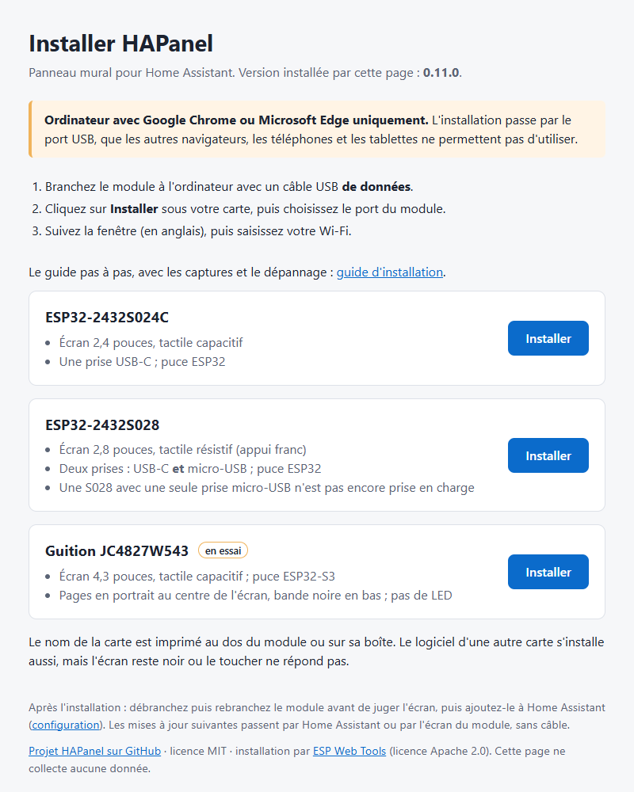
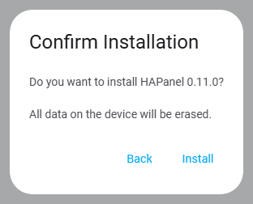

# Installer un module HAPanel

Ce guide s'adresse à une personne qui n'a jamais installé de module ESPHome. Il va
du module neuf, sorti de sa boîte, jusqu'au module relié à votre Wi-Fi ; la suite
est dans [CONFIGURATION.md](CONFIGURATION.md). Comptez 15 minutes. Aucune ligne de
commande, rien à compiler, aucun mot de passe à inventer.

## Ce qu'il vous faut

- **Le module** HAPanel, et le nom de sa carte, imprimé au dos ou sur la boîte :

  | Carte | Écran |
  |---|---|
  | ESP32-2432S024C | 2,4 pouces, tactile capacitif |
  | ESP32-2432S028, prises USB-C **et** micro-USB | 2,8 pouces, tactile résistif (appui franc) |
  | Guition JC4827W543 (en essai) | 4,3 pouces, tactile capacitif ; pages en portrait au centre de l'écran, bande noire en bas, pas de LED |

  Une S028 avec une seule prise micro-USB n'est pas encore prise en charge.
- **Un câble USB de données.** Certains câbles ne font que charger : si l'ordinateur
  ne voit pas le module (étape 2), essayez-en un autre.
- **Un ordinateur avec Google Chrome ou Microsoft Edge**, et uniquement l'un de ces
  deux navigateurs (voir l'avertissement de l'étape 1).
- **Un bloc secteur USB de 1 A** pour l'usage normal. Le port USB d'un ordinateur
  suffit pour l'installation, mais peut faire redémarrer le module en boucle ensuite.
- **Le nom et le mot de passe de votre Wi-Fi.** Le module ne voit que le Wi-Fi
  2,4 GHz : si votre box sépare 2,4 et 5 GHz, choisissez le réseau 2,4 GHz.
- **Home Assistant**, sur le même réseau, avec un compte administrateur.

## 1. Ouvrir la page d'installation

1. Branchez le module à l'ordinateur avec le câble USB.
2. Ouvrez la page d'installation **dans Google Chrome ou Microsoft Edge** :
   <https://cnuma.github.io/HAPanel/>. Elle installe toujours la dernière version
   publiée ; rien n'est à télécharger.

> [!WARNING]
> **Uniquement Chrome ou Edge, sur un ordinateur, même si vous utilisez un autre
> navigateur d'habitude.** Écrire dans le module passe par le port USB, et seuls ces
> deux navigateurs l'autorisent. Avec un autre navigateur, un téléphone ou une
> tablette, la page affiche « Navigateur non compatible » à la place des boutons
> **Installer**.

## 2. Écrire le logiciel dans le module

> [!IMPORTANT]
> **La page efface toujours tout le module** avant d'écrire : logiciel, Wi-Fi et clé
> de chiffrement. Pour un module neuf, c'est ce qu'il faut.
>
> **Module déjà ajouté à Home Assistant** (réinstallation) : avant de cliquer sur
> **Installer**, supprimez-le de Home Assistant (**Paramètres › Appareils et
> services › ESPHome**, le module, menu **⋮**). Après l'installation, ajoutez-le de
> nouveau ([CONFIGURATION.md](CONFIGURATION.md), section 1), puis choisissez-le de
> nouveau dans « Panneau » de son automatisation. Si Home Assistant demande une clé,
> ne saisissez rien : ajoutez le module **par son adresse IP**, affichée sur sa page
> **Menu › À propos** ([Dépannage](CONFIGURATION.md#dépannage)).

1. Cliquez sur **Installer** sous **votre carte**. Le logiciel d'une autre carte
   s'installe aussi, mais l'écran reste noir ou le toucher ne répond pas.
2. Une fenêtre du navigateur liste les ports série. Choisissez **USB Serial (COM…)**,
   puis **Connexion**. Le numéro varie d'un ordinateur à l'autre, et « associé » peut
   suivre. Le haut de la fenêtre nomme le site qui demande le port
   (`cnuma.github.io`) ; la capture ci-dessous a été prise sur un autre site.

**La liste est vide ?** Vérifiez d'abord le navigateur (Chrome ou Edge), puis
changez de câble. Si rien n'y fait, il manque sans doute le **pilote CH340** : c'est
la puce qui relie la prise USB du module à l'ordinateur (constaté sur le module de
référence). Windows 10 et 11 l'installent souvent seuls. Pour le vérifier : clic
droit sur le bouton Démarrer, **Gestionnaire de périphériques**, rubrique
**Ports (COM et LPT)** ; le module y figure sous le nom « USB-SERIAL CH340 (COM…) »
quand le pilote est installé.

Si le pilote manque :

1. Téléchargez-le **uniquement sur le site de son fabricant**, WCH (Nanjing Qinheng
   Microelectronics) :
   - Windows : <https://www.wch-ic.com/downloads/CH341SER_EXE.html>, bouton
     **Download** (fichier `CH341SER.EXE`, certifié par Microsoft) ;
   - macOS : <https://www.wch-ic.com/downloads/CH341SER_MAC_ZIP.html>.
2. Sous Windows, lancez `CH341SER.EXE`, cliquez sur **INSTALL**, puis débranchez et
   rebranchez le module.
3. Recommencez au point 1 : la ligne « USB Serial (COM…) » apparaît dans la liste.

> [!CAUTION]
> Ne prenez pas ce pilote sur un site de téléchargement, un forum ou un lien
> sponsorisé : un pilote s'installe avec les droits les plus élevés de l'ordinateur,
> et une copie modifiée peut l'infecter. Le site de WCH, fabricant de la puce, est la
> seule source fiable.

Les captures de la fenêtre d'installation, ci-dessous, sont des maquettes de la
fenêtre réelle, avec un module et un réseau fictifs.

3. La fenêtre d'installation s'ouvre ; elle est en anglais. Cliquez sur
   **Install HAPanel**.

4. Fenêtre **Confirm Installation** : elle rappelle que tout sera effacé (« All data
   on the device will be erased. »). Cliquez sur **Install**.

5. **Installing** : effacement, puis écriture, en 2 minutes environ. **Gardez cette
   fenêtre visible** : passer à un autre onglet ou à une autre fenêtre peut
   interrompre l'écriture. Ne débranchez pas le module.

6. À la fin, la fenêtre affiche **Installation complete!** : cliquez sur **Next**.

## 3. Relier le module au Wi-Fi

Juste après l'écriture, la fenêtre propose de configurer le Wi-Fi : **Configure
Wi-Fi**.

1. Dans **Network**, choisissez votre réseau 2,4 GHz ; dans **Password**, saisissez
   son mot de passe ; puis **Connect**.

2. Le module rejoint le Wi-Fi : la fenêtre l'annonce (**Device connected to the
   network!**). Fermez-la ; le lien **Add to Home Assistant** qu'elle propose mène
   au même endroit que l'étape suivante.

Vous pouvez maintenant débrancher le module de l'ordinateur et le brancher sur son
bloc secteur : il garde le Wi-Fi.

**Jugez l'écran seulement après cette coupure.** Juste après l'écriture, certaines
cartes (dont la Guition 4,3") gardent l'état laissé par le logiciel précédent :
couleurs inversées, image à l'envers, toucher décalé. Débrancher puis rebrancher
le module remet l'écran à zéro ; c'est ce démarrage-là qui compte.

L'écran affiche « Pas de communication avec Home Assistant » et un point rouge en
haut à droite : c'est normal, Home Assistant n'est pas encore relié (étape suivante).
La date ne s'affiche qu'une fois Home Assistant relié.

**La fenêtre n'a pas proposé le Wi-Fi, ou le module ne s'y connecte pas :** passez par
le point d'accès du module, ci-dessous.

### Autre méthode : depuis un téléphone

Tant qu'il n'a pas de Wi-Fi, le module crée son propre réseau Wi-Fi pendant
15 minutes après sa mise sous tension.

1. Sur le téléphone, ouvrez la liste des réseaux Wi-Fi et choisissez le réseau
   `hapanel-` suivi de six caractères. Il n'a pas de mot de passe.

2. Une page « Wi-Fi captif » s'ouvre seule (sinon, ouvrez <http://192.168.4.1> dans
   le navigateur du téléphone). Touchez votre réseau dans la liste **WiFi Networks** :
   son nom se recopie dans **SSID**. Saisissez son mot de passe dans **Password**,
   puis **Save**.

3. La page affiche « Saved. Connecting... » : le module rejoint votre Wi-Fi, et son
   réseau `hapanel-…` disparaît.

**Le réseau `hapanel-…` n'apparaît pas :** les 15 minutes sont passées. Débranchez
puis rebranchez le module, et recommencez.

## 4. Suite : Home Assistant

Le module est sur votre Wi-Fi. Pour l'ajouter à Home Assistant et choisir ce qu'il
affiche, suivez [CONFIGURATION.md](CONFIGURATION.md), sections 1 à 3. Les mises à
jour suivantes passeront par Home Assistant, sans câble (section 7).

## Dépannage

| Symptôme | Que faire |
|---|---|
| « Navigateur non compatible » à la place des boutons **Installer**, ou aucun port n'est listé | D'abord le navigateur : **Chrome ou Edge sur un ordinateur uniquement** (étape 1). Puis un autre câble USB ; puis le pilote du convertisseur USB-série (étape 2) |
| L'écriture s'arrête en erreur (**Installation failed**) | Débrancher, rebrancher, recommencer l'étape 2 ; essayer un autre port USB de l'ordinateur |
| Pas de proposition de Wi-Fi après l'écriture | Méthode du téléphone (étape 3) |
| Le module ne rejoint pas le Wi-Fi | Réseau 2,4 GHz, mot de passe ; module trop loin de la box |
| Réseau `hapanel-…` absent | Plus de 15 minutes depuis la mise sous tension : débrancher, rebrancher |
| Le module redémarre en boucle | Alimentation trop faible : bloc secteur de 1 A |
| Juste après l'écriture : couleurs inversées, image à l'envers ou toucher décalé | Débrancher le module, attendre quelques secondes, le rebrancher (étape 3) ; ne juger qu'après cette coupure |

Problème une fois dans Home Assistant : [dépannage de la configuration](CONFIGURATION.md#dépannage).
