# Installer un module HAPanel

Ce guide s'adresse à une personne qui n'a jamais installé de module ESPHome. Il va
du module neuf, sorti de sa boîte, jusqu'au module relié à votre Wi-Fi ; la suite
est dans [CONFIGURATION.md](CONFIGURATION.md). Comptez 15 minutes. Aucune ligne de
commande, rien à compiler, aucun mot de passe à inventer.

## Ce qu'il vous faut

- **Le module** HAPanel, et le nom de sa carte, imprimé au dos ou sur la boîte :

  | Carte | Écran | Fichier à télécharger |
  |---|---|---|
  | ESP32-2432S024C | 2,4 pouces, tactile capacitif | `hapanel-2432s024c-factory.bin` |
  | ESP32-2432S028, prises USB-C **et** micro-USB | 2,8 pouces, tactile résistif (appui franc) | `hapanel-2432s028-factory.bin` |
  | Guition JC4827W543 (en essai) | 4,3 pouces, tactile capacitif ; pages en portrait au centre de l'écran, bande noire en bas, pas de LED | `hapanel-jc4827w543-factory.bin` |

  Une S028 avec une seule prise micro-USB n'est pas encore prise en charge.
- **Un câble USB de données.** Certains câbles ne font que charger : si l'ordinateur
  ne voit pas le module (étape 2), essayez-en un autre.
- **Un ordinateur avec Google Chrome ou Microsoft Edge**, et uniquement l'un de ces
  deux navigateurs (voir l'avertissement de l'étape 2).
- **Un bloc secteur USB de 1 A** pour l'usage normal. Le port USB d'un ordinateur
  suffit pour l'installation, mais peut faire redémarrer le module en boucle ensuite.
- **Le nom et le mot de passe de votre Wi-Fi.** Le module ne voit que le Wi-Fi
  2,4 GHz : si votre box sépare 2,4 et 5 GHz, choisissez le réseau 2,4 GHz.
- **Home Assistant**, sur le même réseau, avec un compte administrateur.

## 1. Télécharger le logiciel du module

1. Ouvrez la page des versions :
   <https://github.com/cnuma/HAPanel/releases/latest>.
2. En bas de la page, la rubrique **Assets** liste les fichiers. Cliquez sur le
   fichier `…-factory.bin` **de votre carte** (tableau ci-dessus). Il arrive dans
   votre dossier Téléchargements. S'il y en a déjà un, d'une installation précédente,
   supprimez l'ancien d'abord : le nouveau s'appellerait par exemple
   `hapanel-2432s024c-factory (1).bin`, et l'on risquerait de choisir l'ancien à
   l'étape 3.

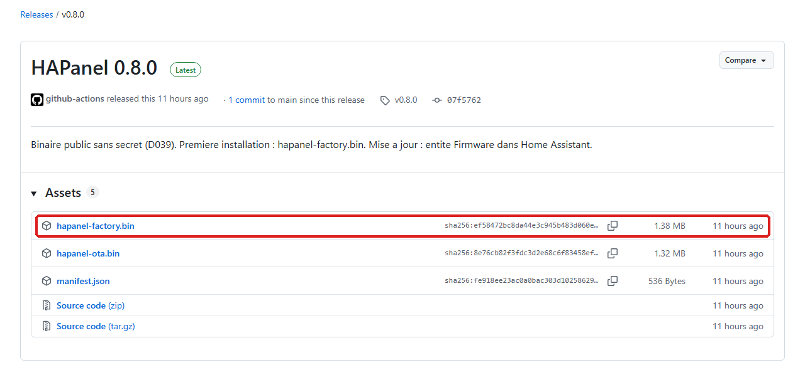

Les autres ne servent pas ici : les fichiers `…-ota.bin` et `manifest….json` servent
aux mises à jour, que Home Assistant fera seul
([CONFIGURATION.md](CONFIGURATION.md), section 7) ; « Source code » est le code du
projet.

## 2. Brancher le module à l'ordinateur

1. Branchez le module à l'ordinateur avec le câble USB.
2. Ouvrez <https://web.esphome.io> **dans Google Chrome ou Microsoft Edge**.

> [!WARNING]
> **Uniquement Chrome ou Edge, même si vous utilisez un autre navigateur d'habitude.**
> Écrire dans le module passe par le port USB, et seuls ces deux navigateurs
> l'autorisent. Firefox, Safari et Brave ne le permettent pas ; les autres
> navigateurs ne sont pas garantis. Avec eux, la page s'ouvre normalement, mais le
> bouton **Connection** ne trouve aucun module ou ne fait rien : on croit à un
> problème de câble et on perd du temps.

3. Cliquez sur **Connection** (la page est en partie en anglais).

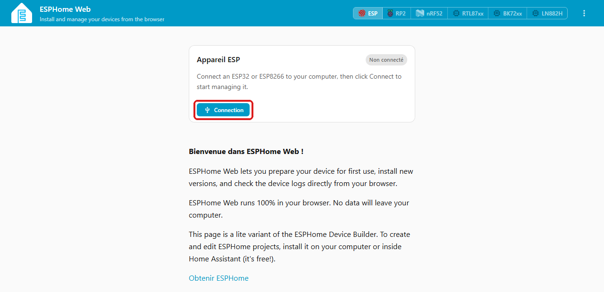

4. Une fenêtre liste les ports série. Choisissez **USB Serial (COM…)**, puis
   **Connexion**. Le numéro varie d'un ordinateur à l'autre, et « associé » peut
   suivre.

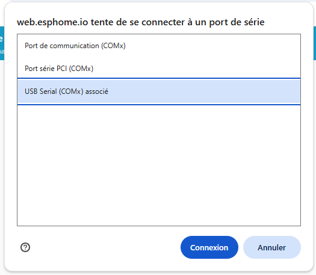

**La liste est vide ?** Vérifiez d'abord le navigateur (Chrome ou Edge), puis
changez de câble. Si rien n'y fait, il manque sans doute le **pilote CH340** : c'est
la puce qui relie la prise USB du module à l'ordinateur (constaté sur le module de
référence). Windows 10 et 11 l'installent souvent seuls. Pour le vérifier : clic
droit sur le bouton Démarrer, **Gestionnaire de périphériques**, rubrique
**Ports (COM et LPT)** ; le module y figure sous le nom « USB-SERIAL CH340 (COM…) »
quand le pilote est installé.

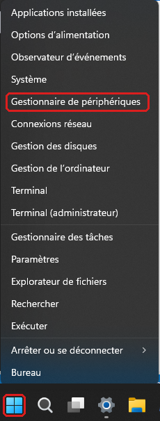

Si le pilote manque :

1. Téléchargez-le **uniquement sur le site de son fabricant**, WCH (Nanjing Qinheng
   Microelectronics) :
   - Windows : <https://www.wch-ic.com/downloads/CH341SER_EXE.html>, bouton
     **Download** (fichier `CH341SER.EXE`, certifié par Microsoft) ;
   - macOS : <https://www.wch-ic.com/downloads/CH341SER_MAC_ZIP.html>.
2. Sous Windows, lancez `CH341SER.EXE`, cliquez sur **INSTALL**, puis débranchez et
   rebranchez le module.
3. Recommencez l'étape 2 : la ligne « USB Serial (COM…) » apparaît dans la liste.

> [!CAUTION]
> Ne prenez pas ce pilote sur un site de téléchargement, un forum ou un lien
> sponsorisé : un pilote s'installe avec les droits les plus élevés de l'ordinateur,
> et une copie modifiée peut l'infecter. Le site de WCH, fabricant de la puce, est la
> seule source fiable.

## 3. Écrire le logiciel dans le module

1. La page indique **Connecté**. Cliquez sur la **petite flèche** à droite du grand
   bouton bleu : « Installer » s'affiche au survol.

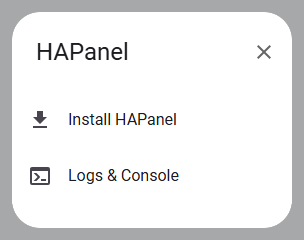

> [!IMPORTANT]
> Pas sur le grand bouton **Préparation pour la première utilisation** : il
> installerait un logiciel ESPHome de base, pas HAPanel.

2. Dans la fenêtre qui s'ouvre, cliquez sur **Choisir un fichier**, prenez
   le fichier `…-factory.bin` de votre carte dans votre dossier Téléchargements, puis
   **Installer**. Les
   explications numérotées de la fenêtre ne vous concernent pas : elles visent ceux
   qui compilent leur propre logiciel.

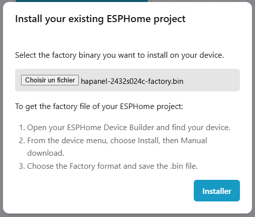

3. L'écriture efface tout ce que le module contenait, puis écrit le logiciel, en
   2 minutes environ. **Gardez cette fenêtre visible** : passer à un autre onglet ou
   à une autre fenêtre peut interrompre l'écriture. Ne débranchez pas le module.

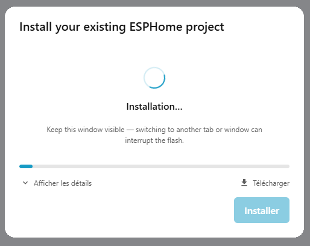

4. À la fin, la fenêtre affiche **Installation finie**.

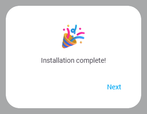

## 4. Relier le module au Wi-Fi

Juste après l'écriture, la page propose de configurer le Wi-Fi : fenêtre
**Configure Wi-Fi**, qui rappelle le nom du module (`hapanel-` suivi de six
caractères) et sa version.

1. Dans **Network**, choisissez votre réseau 2,4 GHz ; dans **Password**, saisissez
   son mot de passe ; puis **Connect**.

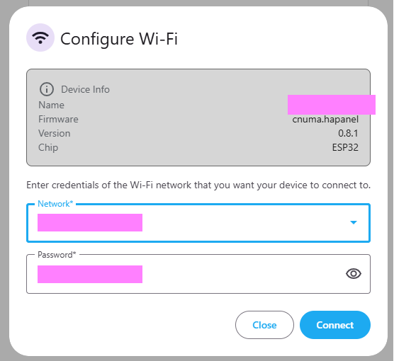

2. Le module rejoint le Wi-Fi : la fenêtre affiche **Provisioned!**. Cliquez sur
   **Close**.

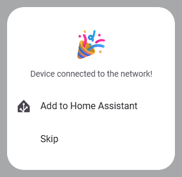

Vous pouvez maintenant débrancher le module de l'ordinateur et le brancher sur son
bloc secteur : il garde le Wi-Fi.

**Jugez l'écran seulement après cette coupure.** Juste après l'écriture, certaines
cartes (dont la Guition 4,3") gardent l'état laissé par le logiciel précédent :
couleurs inversées, image à l'envers, toucher décalé. Débrancher puis rebrancher
le module remet l'écran à zéro ; c'est ce démarrage-là qui compte.

L'écran affiche « Pas de communication avec Home Assistant » et un point rouge en
haut à droite : c'est normal, Home Assistant n'est pas encore relié (étape suivante).
La date ne s'affiche qu'une fois Home Assistant relié.

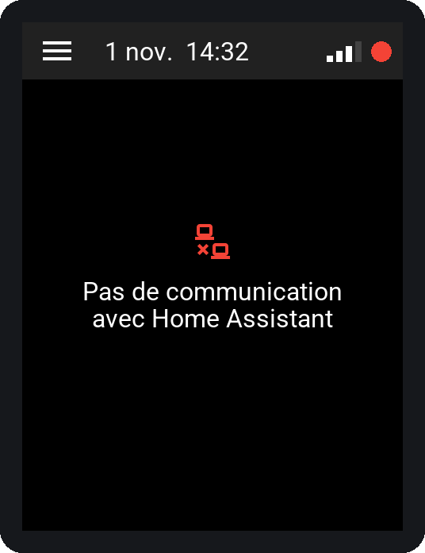

**La page n'a pas proposé le Wi-Fi, ou le module ne s'y connecte pas :** passez par
le point d'accès du module, ci-dessous.

### Autre méthode : depuis un téléphone

Tant qu'il n'a pas de Wi-Fi, le module crée son propre réseau Wi-Fi pendant
15 minutes après sa mise sous tension.

1. Sur le téléphone, ouvrez la liste des réseaux Wi-Fi et choisissez le réseau
   `hapanel-` suivi de six caractères. Il n'a pas de mot de passe.

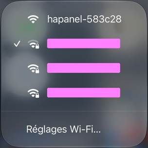

2. Une page « Wi-Fi captif » s'ouvre seule (sinon, ouvrez <http://192.168.4.1> dans
   le navigateur du téléphone). Touchez votre réseau dans la liste **WiFi Networks** :
   son nom se recopie dans **SSID**. Saisissez son mot de passe dans **Password**,
   puis **Save**.

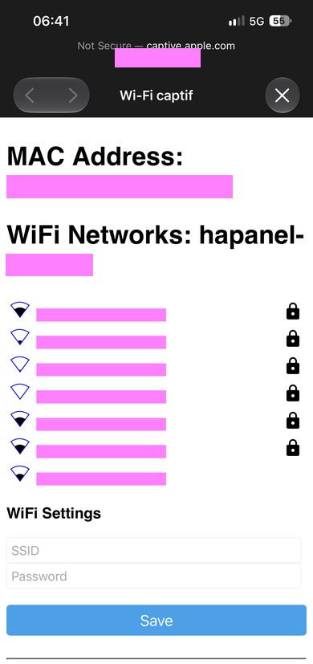

3. La page affiche « Saved. Connecting... » : le module rejoint votre Wi-Fi, et son
   réseau `hapanel-…` disparaît.

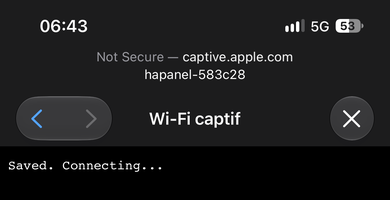

**Le réseau `hapanel-…` n'apparaît pas :** les 15 minutes sont passées. Débranchez
puis rebranchez le module, et recommencez.

## 5. Suite : Home Assistant

Le module est sur votre Wi-Fi. Pour l'ajouter à Home Assistant et choisir ce qu'il
affiche, suivez [CONFIGURATION.md](CONFIGURATION.md), sections 1 à 3. Les mises à
jour suivantes passeront par Home Assistant, sans câble (section 7).

## Dépannage

| Symptôme | Que faire |
|---|---|
| **Connection** ne fait rien, ou aucun port n'est listé | D'abord le navigateur : **Chrome ou Edge uniquement** (étape 2). Puis un autre câble USB ; puis le pilote du convertisseur USB-série (étape 2) |
| L'écriture s'arrête en erreur | Débrancher, rebrancher, recommencer l'étape 3 ; essayer un autre port USB de l'ordinateur |
| Pas de proposition de Wi-Fi après l'écriture | Méthode du téléphone (étape 4) |
| Le module ne rejoint pas le Wi-Fi | Réseau 2,4 GHz, mot de passe ; module trop loin de la box |
| Réseau `hapanel-…` absent | Plus de 15 minutes depuis la mise sous tension : débrancher, rebrancher |
| Le module redémarre en boucle | Alimentation trop faible : bloc secteur de 1 A |
| Juste après l'écriture : couleurs inversées, image à l'envers ou toucher décalé | Débrancher le module, attendre quelques secondes, le rebrancher (étape 4) ; ne juger qu'après cette coupure |

Problème une fois dans Home Assistant : [dépannage de la configuration](CONFIGURATION.md#dépannage).
