# Utiliser HAPanel

HAPanel est un petit écran tactile mural relié à Home Assistant. Il sert à
régler le chauffage de la pièce, consulter la météo et le planning, et lancer des
scénarios de la maison.

*Les images sont des maquettes : les valeurs sont des exemples, et l'écran réel
peut légèrement différer.*

## L'essentiel

- **La barre du haut** est présente sur toutes les pages, comme sur un téléphone :
  à gauche le bouton **☰**, qui ouvre le Menu (il n'apparaît pas sur le Menu), puis le
  titre de la page (la date et l'heure sur l'accueil) ; à droite le Wi-Fi et le point
  de connexion à Home Assistant (vert : relié, rouge : non relié). Une **flèche
  violette qui clignote** à côté du Wi-Fi annonce une nouvelle version du logiciel
  (voir « Mise à jour » plus bas).
- **La maison**, en bas au centre, ramène à l'accueil. L'accueil n'a pas de barre en
  bas.
- La LED et la luminosité de l'écran se règlent depuis le panneau lui-même :
  **Menu › Réglages**.
- Après **1 minute sans toucher**, le panneau revient à l'accueil et l'écran
  s'éteint.
- Quand l'écran est éteint, **le premier toucher ne fait que le rallumer** : il ne
  déclenche aucune commande.
- Le panneau n'affiche jamais une valeur douteuse comme si elle était sûre. Un
  texte orange signale une valeur manquante, ancienne ou indisponible.

## Accueil

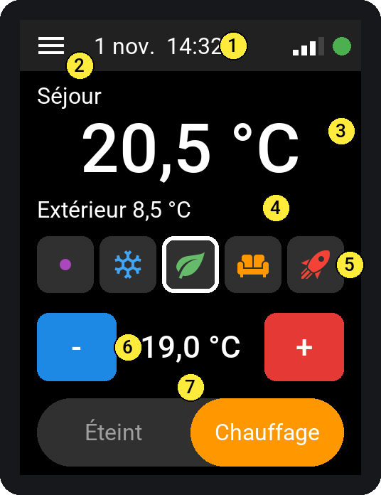

| Repère | Élément | Utilisation |
|---|---|---|
| 1 | Barre du haut : date, heure, Wi-Fi, point de connexion | Point vert : relié à Home Assistant. Point rouge : non relié. |
| 2 | ☰ | Ouvre le Menu, la liste des pages. |
| 3 | Température de la pièce | Affichage seul. |
| 4 | Température extérieure | Affichage seul. |
| 5 | Préréglages : Manuel, Hors-gel, Éco, Confort, Boost | Touchez une icône pour changer. Le préréglage actif est entouré de blanc. |
| 6 | Consigne, avec **-** et **+** | Chaque toucher change de 0,5 °C. L'envoi part 2 secondes après le dernier toucher. |
| 7 | Glissière Éteint / Chauffage | Touchez le côté inactif, ou faites glisser la pastille. |

**Après une commande**, la valeur demandée reste en attente jusqu'à la confirmation
de Home Assistant. Sans confirmation au bout de 10 secondes, l'écran revient à la
valeur réelle : la commande n'a pas abouti.

**Quand le thermostat est verrouillé**, les réglages ne répondent plus et la
pastille de la glissière devient grise.

### Autres affichages de l'accueil

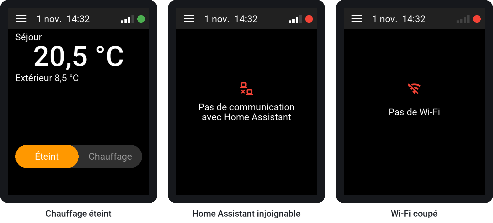

- **Chauffage éteint :** préréglages et consigne disparaissent.
- **Sans Home Assistant ou sans Wi-Fi :** un message donne la cause et aucune
  commande ne peut partir. L'écran reste allumé et la navigation continue de
  fonctionner.

## Menu

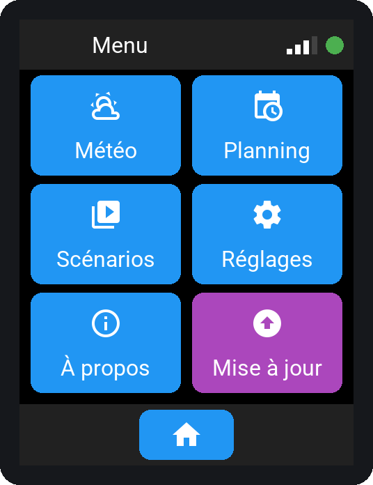

Touchez une tuile pour ouvrir la page correspondante : Météo, Planning, Scénarios,
Réglages ou À propos. Une tuile violette « Mise à jour » s'ajoute quand une nouvelle
version attend (voir [Mise à jour](#mise-à-jour)). Pour revenir à l'accueil, touchez la maison en bas. Le bouton
☰ n'apparaît pas ici : vous êtes déjà sur le Menu.

## Météo

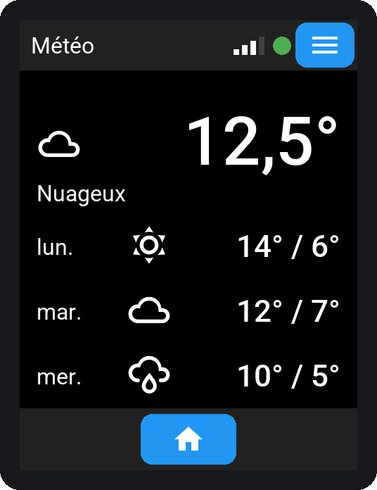

Conditions actuelles en haut, puis prévisions sur 3 jours : température maximale /
minimale. Cette page ne commande rien.

## Planning

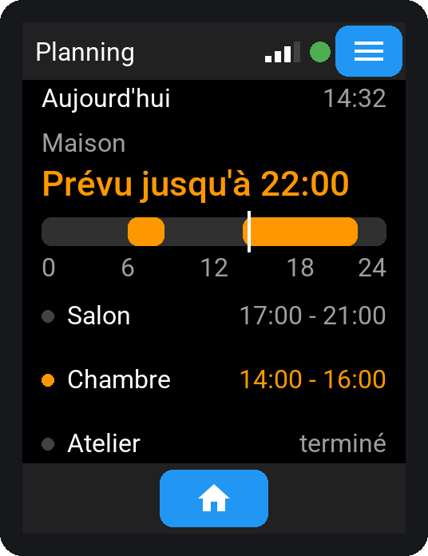

- **En haut :** le calendrier principal, avec son résumé et la frise de la journée
  de 0 à 24 h. Les plages orange sont prévues, le trait blanc marque l'heure
  actuelle.
- **En dessous :** jusqu'à 3 autres calendriers. Leur point est orange pendant un
  créneau.

Le planning montre ce qui est **prévu** au calendrier, pas l'état réel du chauffage.
Cette page ne commande rien.

## Scénarios

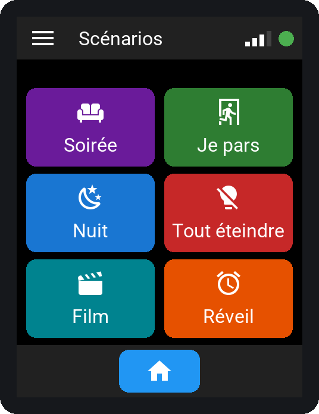

Chaque bouton a son nom et, selon la configuration, sa couleur et son icône. Un bouton
gris ne répond pas : la demande est en cours ou Home Assistant est déconnecté.

**Un seul toucher lance le scénario, sans confirmation.** Le message sous le titre
indique ensuite ce qui se passe :

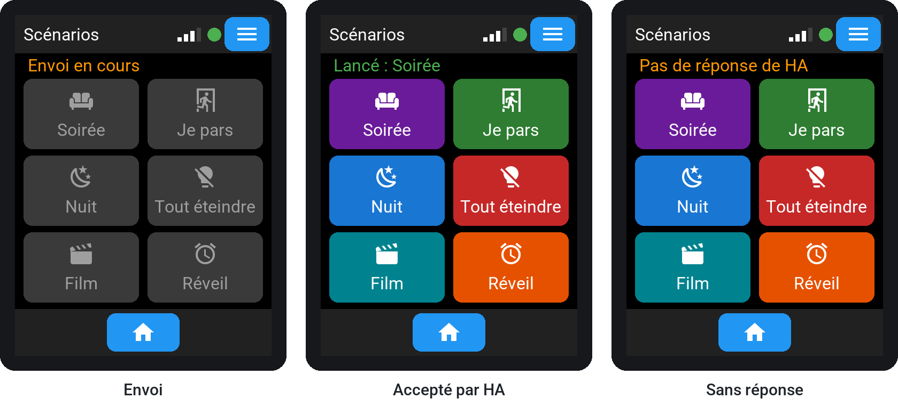

| Message | Signification |
|---|---|
| Envoi en cours | La demande est partie. Les boutons sont bloqués pendant l'attente. |
| Lancé : nom | Home Assistant a accepté. Cela ne garantit pas que le scénario ait réussi jusqu'au bout. |
| Refusé par HA | Le scénario n'est pas disponible ou n'existe plus. |
| Pas de réponse de HA | Aucune réponse en 10 secondes. Vérifiez le résultat avant de relancer. |
| Aucun scénario choisi | Rien n'est encore configuré pour ce panneau. |

Un bouton marqué **Indisponible** ne peut pas être touché.

## À propos

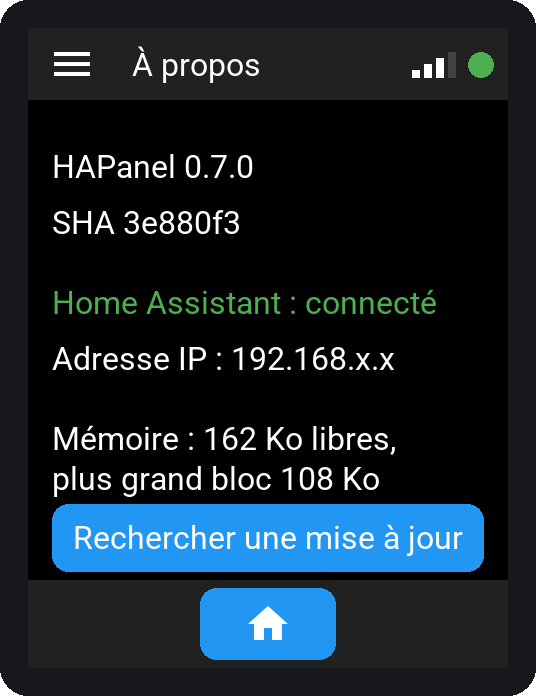

Version du logiciel, connexion à Home Assistant, adresse IP du panneau sur le réseau
(« aucune » sans Wi-Fi) et mémoire. Ces informations sont utiles en cas de dépannage.
En dessous, le bouton **Rechercher une mise à jour** demande tout de suite s'il existe
une nouvelle version ; il affiche ensuite « À jour », « Version … disponible »,
« Recherche impossible » ou « Pas de Wi-Fi ».

## Réglages

Ouvrez **Menu › Réglages** pour régler la LED et l'écran de ce panneau, par exemple
pour qu'il soit discret dans une chambre. Aucun code n'est demandé, et la page
fonctionne même sans Home Assistant ni Wi-Fi.

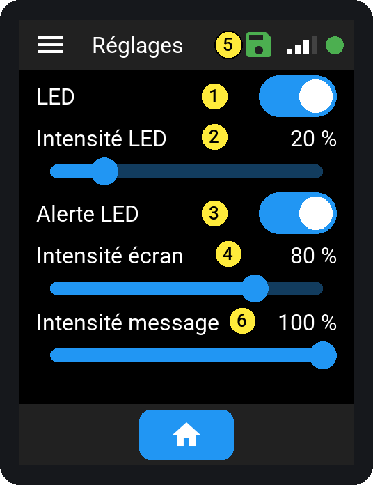

| Repère | Réglage | Utilisation |
|---|---|---|
| 1 | LED | Interrupteur. Arrêté : la LED ne montre plus l'état du chauffage. |
| 2 | Intensité LED | Faites glisser, par pas de 5 %. 100 % est le maximum prévu, déjà discret ; 20 % par défaut. |
| 3 | Alerte LED | Interrupteur. Arrêté : plus de rouge clignotant en cas d'anomalie ; seul l'écran la montre. |
| 4 | Intensité écran | Faites glisser, de 20 à 100 %. L'écran continue de baisser tout seul dans le noir, et ne devient jamais illisible. |
| 5 | Disquette | Apparaît après un changement : grise pendant l'enregistrement, verte quand il est fait. |

- **Un curseur s'applique quand vous levez le doigt** : la valeur affichée suit le
  doigt, la LED ou l'écran change au relâchement.
- **Les réglages sont gardés** après une coupure de courant. Après un changement,
  une disquette apparaît dans la barre du haut (repère 5) : **grise** pendant 5 s, le temps
  d'enregistrer (ne pas débrancher), puis **verte** 2 s quand c'est enregistré. Elle
  apparaît aussi, sur n'importe quelle page, quand le réglage vient de Home Assistant.
- **Ce sont les mêmes réglages** que sur la page de l'appareil dans Home Assistant :
  un changement d'un côté apparaît aussitôt de l'autre.

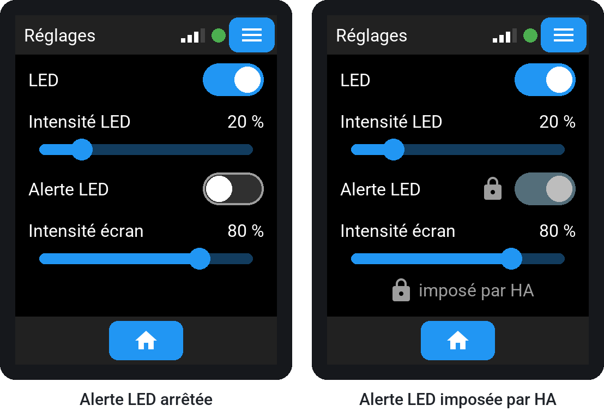

**Interrupteur arrêté :** fond sombre bordé de gris, bouton blanc à gauche. En marche :
fond bleu, bouton à droite.

**Cadenas :** ce réglage est imposé par Home Assistant (automatisation du module) ;
il ne réagit pas au toucher, et « imposé par HA » est rappelé en bas de la page. Pour
le régler depuis le panneau, mettez-le sur « Ne pas imposer » dans l'automatisation
(voir [la configuration](CONFIGURATION.md)).

## Écran et LED

**Luminosité de l'écran :** elle baisse dans une pièce sombre et remonte quand la
pièce est éclairée, en quelques secondes. Le réglage « Intensité écran » (page
Réglages) la diminue en plus, partout.

**LED de façade :** elle montre l'état du chauffage même écran éteint.

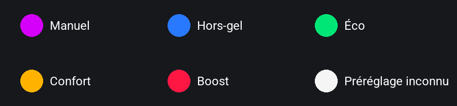

| LED | Signification |
|---|---|
| Couleur qui « respire » | Chauffage allumé, dans le préréglage de cette couleur. |
| Éteinte | Chauffage éteint. |
| Rouge clignotant | Anomalie : Home Assistant déconnecté, ou température ou chauffage non reçu, ancien ou indisponible. |
| Deux éclairs violets toutes les 10 s | Une nouvelle version du logiciel attend (voir « Mise à jour »). Entre les éclairs, la LED montre le chauffage comme d'habitude. |

Boost est un rouge qui respire doucement, l'anomalie un rouge qui clignote franchement.
Manuel est un violet qui respire, la mise à jour deux éclairs violets brefs.

La respiration s'éteint un instant au creux de chaque cycle. Selon les réglages du
module (page Réglages, une chambre par exemple), la LED peut être éteinte en
permanence et l'alerte désactivée : seul l'écran montre alors une anomalie.

## Mise à jour

Quand une nouvelle version du logiciel est publiée, le panneau la voit la nuit suivante
(il vérifie chaque nuit à 3 h), à son prochain démarrage, ou tout de suite avec le bouton
**Rechercher une mise à jour** de la page À propos :

- une **flèche violette clignote** dans la barre du haut, à côté du Wi-Fi ; pendant
  l'enregistrement d'un réglage, la disquette prend sa place quelques secondes ;
- la **LED** fait deux éclairs violets toutes les 10 secondes, à son intensité
  habituelle ; avec « LED » arrêtée dans les Réglages, seule la flèche le montre.

Pour l'installer depuis le panneau : **Menu**, tuile violette **Mise à jour**, puis
**Installer**. Le message « Mise à jour en cours, module indisponible » reste affiché
2 à 3 minutes, sans réagir au toucher, puis le panneau redémarre dans la nouvelle
version. En cas d'échec, un message le dit : touchez **Fermer** et réessayez plus tard.

Elle s'installe aussi depuis Home Assistant : page de l'appareil, entité **Firmware**,
**Installer** (voir [le déploiement](DEPLOIEMENT_PUBLIC.md), § 4). La flèche et les
éclairs disparaissent pendant l'installation. Un panneau installé depuis un ordinateur
de l'atelier (binaire privé) n'affiche jamais la flèche, ni le bouton de recherche, ni
la tuile.

## Message d'accueil

Quand quelqu'un arrive après une absence, le panneau peut afficher un message de
bienvenue en plein écran, avec la météo. La LED change alors de couleur en continu.
Le message disparaît après 3 minutes. Pour le fermer avant, touchez **la croix** en
haut à droite, ou n'importe où sur l'écran : rien d'autre n'est déclenché.

## Textes orange

| Texte | Signification |
|---|---|
| non reçu | Le panneau n'a pas encore reçu la valeur depuis son démarrage. |
| indisponible | Home Assistant ne connaît pas la valeur actuellement. |
| périmé | Aucune nouvelle valeur depuis 15 minutes. |
| HA non connecté | Le panneau n'est pas relié à Home Assistant. |

Si un de ces messages persiste, consultez la section Dépannage de
[la configuration](CONFIGURATION.md#dépannage).
